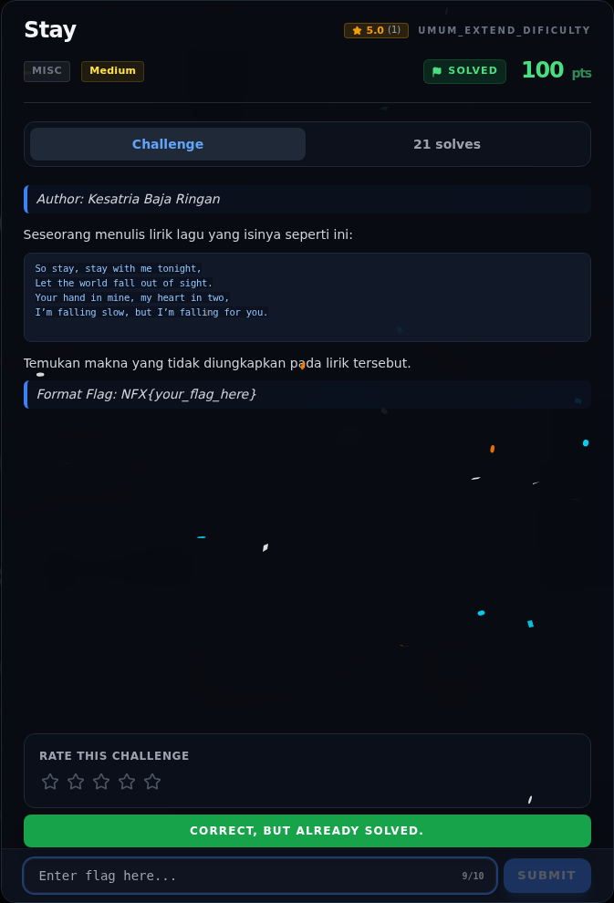

# Stay — Flag & Verifikasi

[← Overview](30-stay.md) · [Index](index.md)

> **Langkah 4/6 — Flag.** Plaintext hasil decode:
>
> **Titik penting:** NFX{st4y_w1th_m3_1n_th3_d4rk}
>
> **Berikutnya:** [Bukti / Evidence](30-stay-05-bukti-evidence.md)

> **Flag:** `NFX{st4y_w1th_m3_1n_th3_d4rk}`
> **Status:** `VERIFIED`

Plaintext hasil decode:

```text
NXCTF{st4y_w1th_m3_1n_th3_d4rk}
```

Flag platform (file `flags/wave2/Stay.txt`):

```text
NFX{st4y_w1th_m3_1n_th3_d4rk}
```

Verifikasi:

- 176 karakter → 352 bit → 44 byte, tepat.
- Base64 valid dan decode 33 byte.
- XOR `falling` menghasilkan plaintext yang dapat dibaca.
- Assertion terhadap `NXCTF{...}` PASS.
- Prefix dinormalisasi ke `NFX` sesuai flag platform.

### Bukti submit di platform



*Submit flag di platform: `CORRECT, BUT ALREADY SOLVED.`*

> **Verifikasi platform:** flag sudah diterima. Recheck 2026-11-09 mengembalikan `Correct, but already solved.`
