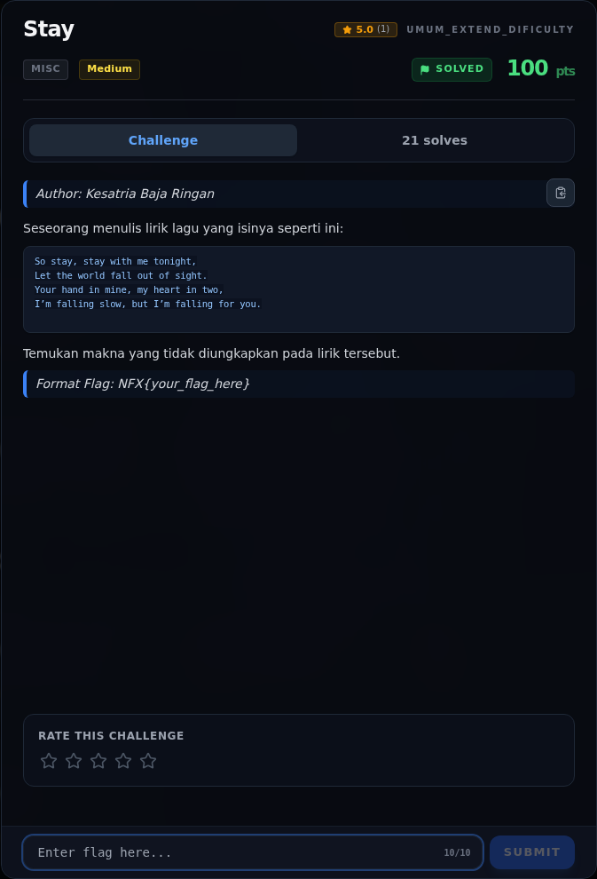
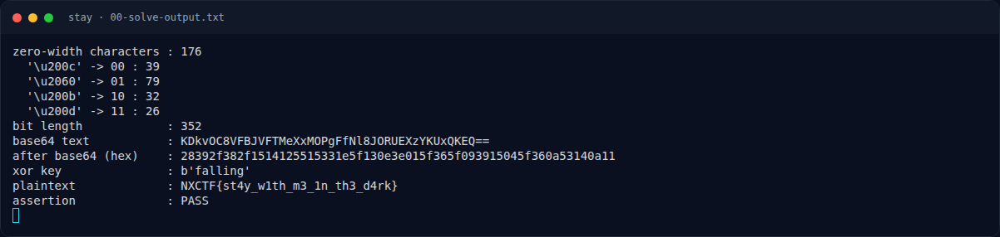
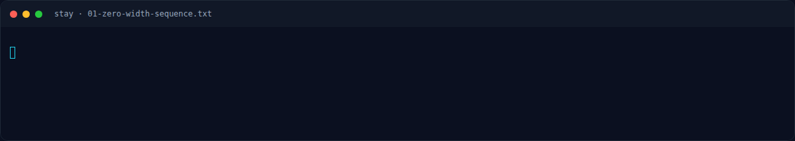
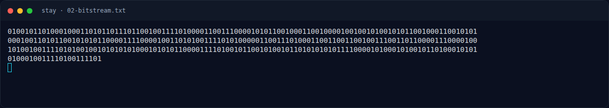
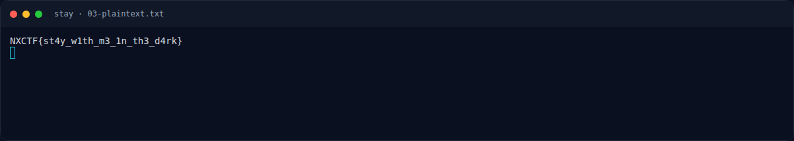
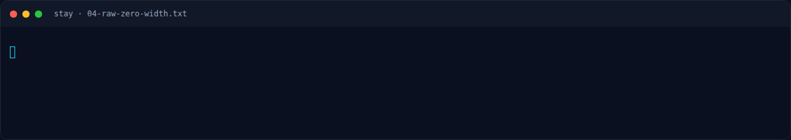
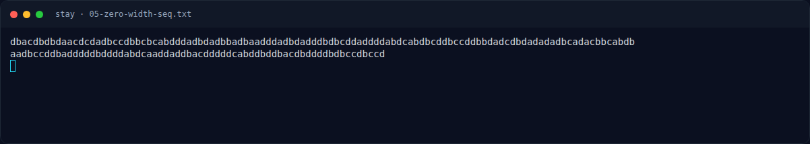
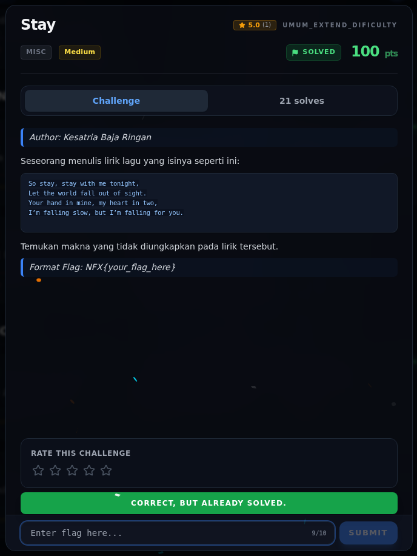

# Stay — Evidence / Bukti

8 screenshot7 transkrip / script

[← Overview](30-stay.md) · [Index](index.md)

> **Langkah 5/6 — Bukti / Evidence.** Semua bukti berada di writeups/assets/stay/.
>
> **Titik penting:** arsip screenshot dan transkrip
>
> **Berikutnya:** [Referensi](30-stay-06-referensi.md)

## Arsip Evidence

> Semua file berasal dari `assets/stay/`. Screenshot platform dan terminal adalah bukti asli dari sesi solve; transkrip mentah tetap ditautkan di bagian bawah.

### Platform

<figure><figcaption>00-challenge-platform.png</figcaption></figure>

*Challenge brief asli di platform NFX CTF 2026.*

<figure><figcaption>Terminal evidence (real)</figcaption></figure>

*Terminal evidence (real).*

### Terminal (arsip sesi)

<figure><figcaption>term-00-solve-output.png</figcaption></figure>

*Terminal evidence — `00-solve-output.txt` (arsip transkrip sesi solve).*

<figure><figcaption>term-01-zero-width-sequence.png</figcaption></figure>

*Terminal evidence — `01-zero-width-sequence.txt` (arsip transkrip sesi solve).*

<figure><figcaption>term-02-bitstream.png</figcaption></figure>

*Terminal evidence — `02-bitstream.txt` (arsip transkrip sesi solve).*

<figure><figcaption>term-03-plaintext.png</figcaption></figure>

*Terminal evidence — `03-plaintext.txt` (arsip transkrip sesi solve).*

<figure><figcaption>term-04-raw-zero-width.png</figcaption></figure>

*Terminal evidence — `04-raw-zero-width.txt` (arsip transkrip sesi solve).*

<figure><figcaption>term-05-zero-width-seq.png</figcaption></figure>

*Terminal evidence — `05-zero-width-seq.txt` (arsip transkrip sesi solve).*

### Transkrip mentah & script

- [`00-solve-output.txt`](assets/stay/00-solve-output.txt)
- [`01-zero-width-sequence.txt`](assets/stay/01-zero-width-sequence.txt)
- [`02-bitstream.txt`](assets/stay/02-bitstream.txt)
- [`03-plaintext.txt`](assets/stay/03-plaintext.txt)
- [`04-raw-zero-width.txt`](assets/stay/04-raw-zero-width.txt)
- [`05-zero-width-seq.txt`](assets/stay/05-zero-width-seq.txt)
- [`solve_stay.py`](assets/stay/solve_stay.py)

## Validasi platform (real)

*Screenshot asli dari platform NFX CTF 2026. Platform menjawab
`CORRECT, BUT ALREADY SOLVED.` untuk flag ini.*

## Tabel Evidence

Semua bukti berada di `writeups/assets/stay/`.

| Bukti | File | Keterangan |
|---|---|---|
| Output solver | `00-solve-output.txt` | Hitungan karakter, bit, Base64, hex, plaintext |
| Urutan zero-width | `01-zero-width-sequence.txt` | 176 karakter asli |
| Bitstream | `02-bitstream.txt` | 352 bit (`0`/`1`) |
| Plaintext | `03-plaintext.txt` | `NXCTF{...}` |
| Zero-width mentah | `04-raw-zero-width.txt` | Salinan `stay_zw_raw.txt` (528 byte) |
| Sequence `a/b/c/d` | `05-zero-width-seq.txt` | Salinan `stay_zw_seq.txt` (176 byte) |
| Solver | `solve_stay.py` | Script yang dijalankan |