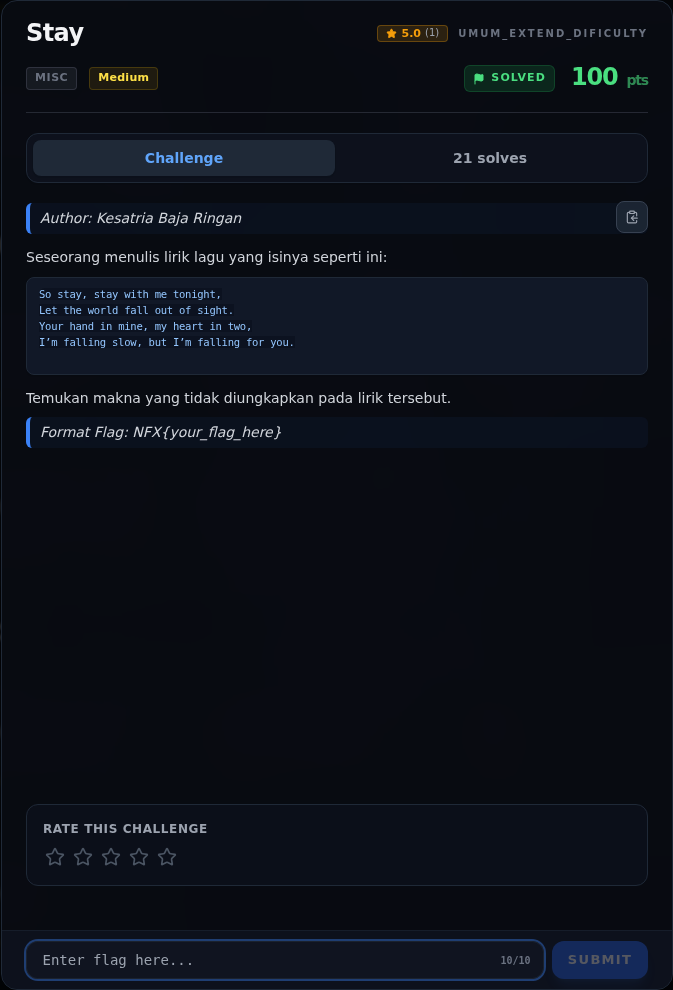
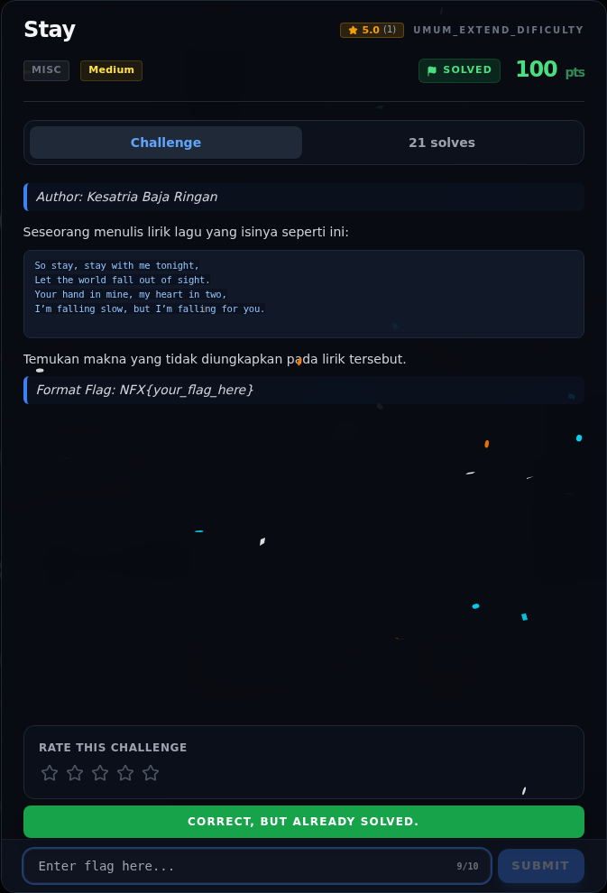

# Stay

Track Umum / Extend · MiscMedium340 poinVERIFIED

| Field | Nilai |
|---|---|
| Event | `umum_Extend` |
| Kategori | `Misc` |
| Difficulty | `Medium` |
| Poin | `340` |
| Author | `Kesatria Baja Ringan` |
| Solves | `9` |
| Tools | python3 |
| Flag | `NFX{st4y_w1th_m3_1n_th3_d4rk}` |
| Status | `VERIFIED` |

[← Kembali ke Index](index.md)

## Challenge Brief (platform)

*Challenge brief asli di platform NFX CTF 2026.*

## Alur & Titik Penting

| # | Langkah | Titik penting | Buka |
|---:|---|---|---|
| 1 | Recon | cat -v stay_zw_raw.txt \| head -2 | [Buka](30-stay-01-recon.md) |
| 2 | Analisis | Kita hanya mengambil karakter yang ada di tabel mapping, sesuai urutan kemunculannya di teks. | [Buka](30-stay-02-analisis.md) |
| 3 | Penyelesaian | python3 solve_stay.py | [Buka](30-stay-03-penyelesaian.md) |
| 4 | Flag | NFX{st4y_w1th_m3_1n_th3_d4rk} | [Buka](30-stay-04-flag.md) |
| 5 | Bukti / Evidence | arsip screenshot dan transkrip | [Buka](30-stay-05-bukti-evidence.md) |
| 6 | Referensi | — | [Buka](30-stay-06-referensi.md) |

## TL;DR

- Tidak ada attachment: payload ada di **teks lirik pada deskripsi challenge**.
- Di antara huruf-huruf lirik disisipkan **176 karakter zero-width** dari
  empat jenis code point.
- Setiap karakter membawa **2 bit**; 176 × 2 = 352 bit = **44 byte**.
- 44 byte itu adalah Base64:
  `KDkvOC8VFBJVFTMeXxMOPgFfNl8JORUEXzYKUxQKEQ==`.
- Setelah Base64 decode (33 byte) dan XOR dengan key `falling`, muncul
  `NXCTF{st4y_w1th_m3_1n_th3_d4rk}`.
- Flag platform: `NFX{st4y_w1th_m3_1n_th3_d4rk}`.

Pratinjau evidence. Buka halaman <a href="30-stay-05-bukti-evidence.html">Evidence / Bukti</a> untuk semua screenshot dan transkrip.

## Navigasi Halaman

<a class="nx-page-card" href="30-stay-01-recon.html"><b>Recon</b>Enumerasi target dan bukti awal</a>
<a class="nx-page-card" href="30-stay-02-analisis.html"><b>Analisis</b>Membaca alur dan akar masalah</a>
<a class="nx-page-card" href="30-stay-03-penyelesaian.html"><b>Penyelesaian</b>Baca bagian ini</a>
<a class="nx-page-card" href="30-stay-04-flag.html"><b>Flag</b>Flag dan verifikasi platform</a>
<a class="nx-page-card" href="30-stay-05-bukti-evidence.html"><b>Bukti / Evidence</b>Screenshot, transkrip, dan artefak</a>
<a class="nx-page-card" href="30-stay-06-referensi.html"><b>Referensi</b>Sumber dan bacaan lanjutan</a>

