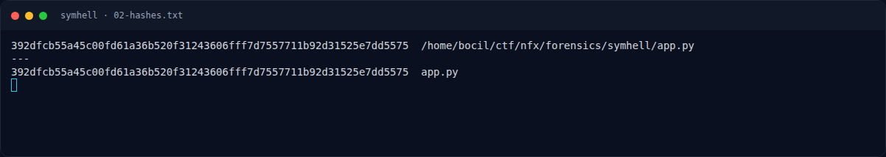

# SymHell — Triage awal

[← Overview](31-symhell.md) · [Index](index.md)

> **Langkah 2/7 — Triage awal.** Bagian penting app.py:
>
> **Titik penting:** { } [ ] ( ) ~ ! - _ . / \ \| & ; < > = + , : " ' @ % ^  spasi tab
>
> **Berikutnya:** [Analisis](31-symhell-03-analisis.md)

## 1.4 Triage awal

Bagian penting `app.py`:

```python
line = data.decode(errors="ignore").strip()
...
# Filter: Block letters, digits, wildcards ?, *, hash #, and herestrings <<<
if re.search(r"[a-zA-Z0-9?*#]|\<{3}", line):
    conn.sendall(DENIED_MSG.encode())
    continue

exec_path = shutil.which("bash") or "/bin/bash"
res = subprocess.run(
    line,
    shell=True,
    executable=exec_path,
    capture_output=True,
    text=True,
    timeout=7,
)
out = res.stdout
if not out:
    out = res.stderr or "[!] No output returned"
```

**Temuan:**

- Validasi bersifat **blacklist karakter pada string input**.
- Shell tetap melakukan ekspansi (parameter, command substitution, glob,
  tilde) setelah validasi.
- Jika stdout kosong, stderr dikirim ke client. Ini penting untuk leak.

Karakter yang masih diizinkan antara lain:

```text
$ { } [ ] ( ) ~ ! - _ . / \ | & ; < > = + , : " ' @ % ^ ` spasi tab
```

### Evidence langkah ini



*Terminal evidence — transkrip langkah — `term-02-hashes.png`.*

**Berkas mentah terkait:**

- [`03-exploit-transcript.txt`](assets/symhell/03-exploit-transcript.txt)
- [`02-hashes.txt`](assets/symhell/02-hashes.txt)
- [`exploit_local.txt`](assets/symhell/exploit_local.txt)
