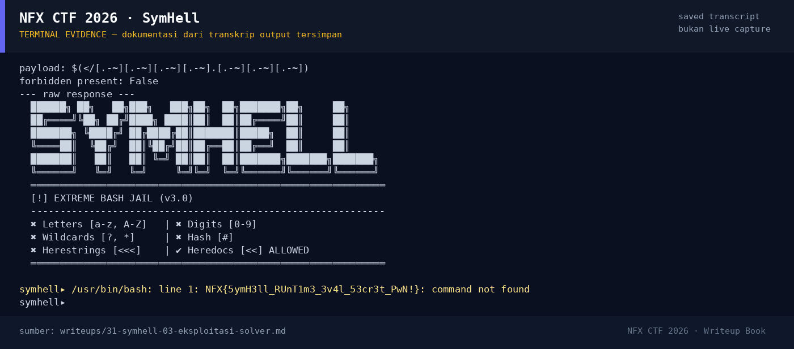

# SymHell — Evidence / Bukti

1 screenshot4 transkrip / script

[← Overview](31-symhell.md) · [Index](index.md)

## Arsip Evidence

> Semua file di bawah berasal dari folder `assets/symhell/`. Screenshot ditempel langsung; file teks/script ditautkan.

### Screenshot

<figure><figcaption>98-terminal-evidence.png</figcaption></figure>

### Transkrip / file pendukung

- [`02-hashes.txt`](assets/symhell/02-hashes.txt)
- [`03-exploit-transcript.txt`](assets/symhell/03-exploit-transcript.txt)
- [`app.py`](assets/symhell/app.py)
- [`exploit_local.txt`](assets/symhell/exploit_local.txt)

## Tabel Evidence

Semua bukti berada di `writeups/assets/symhell/`.

| Bukti | File | Keterangan |
|---|---|---|
| Transcript exploit | `03-exploit-transcript.txt` | Payload, cek filter, respons service (ANSI dibersihkan) |
| Transcript mentah | `exploit_local.txt` | Output asli termasuk escape ANSI |
| Hash source | `02-hashes.txt` | SHA-256 `app.py` |
| Source service | `app.py` | Salinan `forensics/symhell/app.py` |