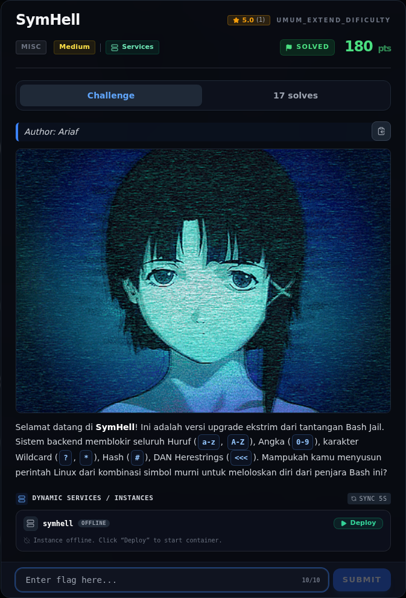

# SymHell — Referensi

[← Overview](31-symhell.md) · [Index](index.md)

> **Langkah 7/7 — Referensi.** Referensi
>
> **Titik penting:** —
>
> **Selesai.** Kembali ke [Overview](31-symhell.md).

- `forensics/symhell/app.py` — source service.
- `flags/forensics/symhell.txt` — flag terverifikasi.
- Bash manual: command substitution `$(<file)`, pathname expansion, bracket
  expressions.
- Writeup referensi `10-symhell.md` (endpoint publik dan strategi glob).

### Evidence langkah ini

*Challenge brief asli di platform NFX CTF 2026.*
