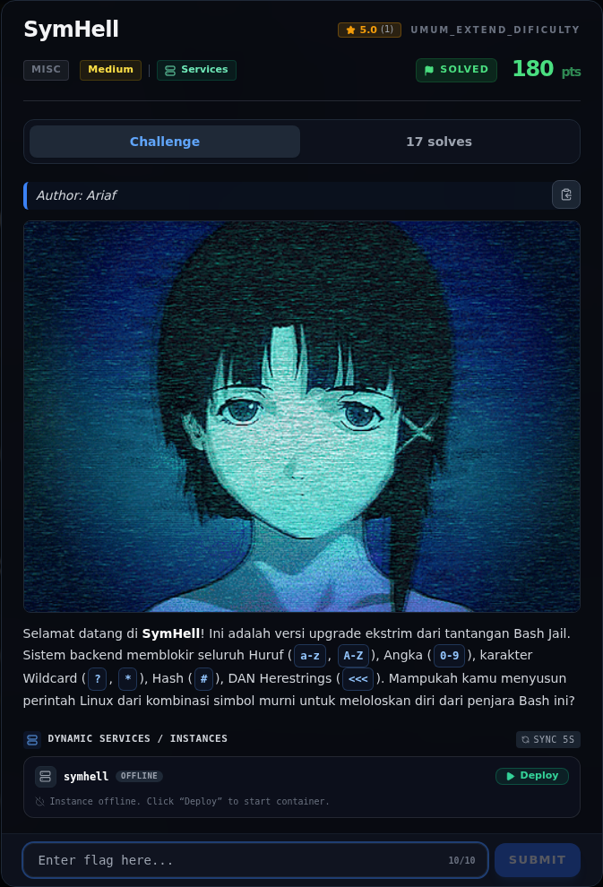
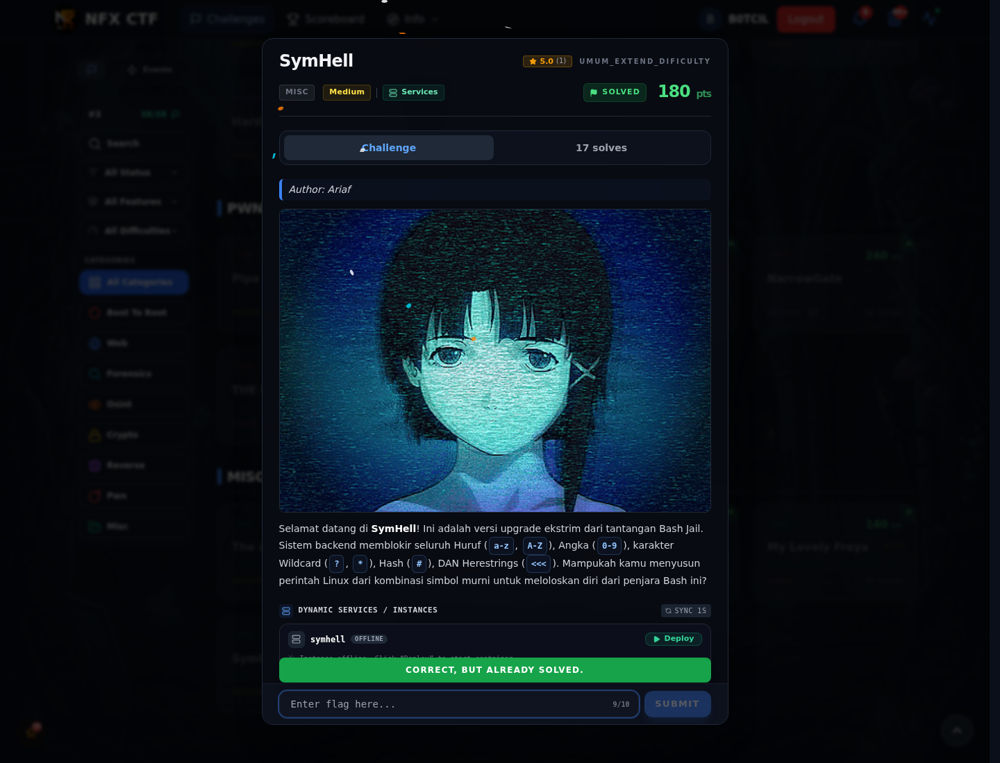

# SymHell

Track Umum / Extend · MiscMedium340 poinVERIFIED

| Field | Nilai |
|---|---|
| Event | `umum_Extend` |
| Kategori | `Misc` |
| Difficulty | `Medium` |
| Poin | `340` |
| Author | `Ariaf` |
| Solves | `9` |
| Tools | strings, sage, git |
| Flag | `NFX{5ymH3ll_RUnT1m3_3v4l_53cr3t_PwN!}` |
| Status | `VERIFIED` |

[← Kembali ke Index](index.md)

## Challenge Brief (platform)

*Challenge brief asli di platform NFX CTF 2026.*

## TL;DR

- Service menjalankan input pengguna dengan `subprocess.run(line, shell=True,
  executable=bash)` setelah memblokir huruf, angka, `?`, `*`, `#`, dan `<<<`.
- Filter hanya memeriksa **karakter mentah input**, bukan hasil ekspansi
  shell.
- Dengan hanya simbol, kita bisa memakai:
  - **command substitution** `$(<file)` yang membaca isi file (pengganti
    `cat`), dan
  - **bracket glob** `[.-~]` — range ASCII `'.'` (0x2E) sampai `'~'`
    (0x7E) — untuk mencocokkan nama file tanpa menulis huruf.
- Payload:
  `$(</[.-~][.-~][.-~][.-~].[.-~][.-~][.-~])`
- Payload membaca `/flag.txt`. Hasilnya menjadi nama command; bash gagal
  mengeksekusinya dan mencetak flag ke **stderr**:
  `bash: line 1: NFX{...}: command not found`.
- Server mengembalikan stderr jika stdout kosong, sehingga flag bocor.

Pratinjau evidence. Buka halaman <a href="31-symhell-06-bukti-evidence.html">Evidence / Bukti</a> untuk semua screenshot dan transkrip.

## Navigasi Halaman

<a class="nx-page-card" href="31-symhell-01-recon.html"><b>Recon</b>Enumerasi target dan bukti awal</a>
<a class="nx-page-card" href="31-symhell-02-triage-awal.html"><b>Triage awal</b>Baca bagian ini</a>
<a class="nx-page-card" href="31-symhell-03-analisis.html"><b>Analisis</b>Membaca alur dan akar masalah</a>
<a class="nx-page-card" href="31-symhell-04-penyelesaian.html"><b>Penyelesaian</b>Baca bagian ini</a>
<a class="nx-page-card" href="31-symhell-05-flag.html"><b>Flag</b>Flag dan verifikasi platform</a>
<a class="nx-page-card" href="31-symhell-06-bukti-evidence.html"><b>Bukti / Evidence</b>Screenshot, transkrip, dan artefak</a>
<a class="nx-page-card" href="31-symhell-07-referensi.html"><b>Referensi</b>Sumber dan bacaan lanjutan</a>

