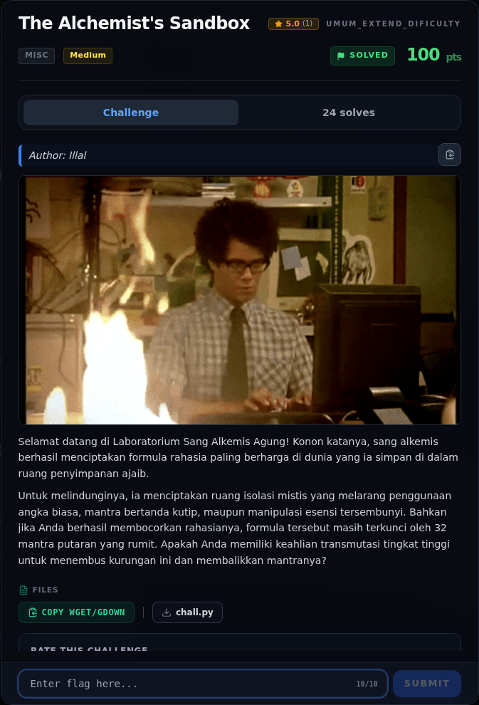

# The Alchemist's Sandbox — Recon

[← Overview](32-the-alchemists-sandbox.md) · [Index](index.md)

> **Langkah 1/10 — Recon.** Tidak ada service; challenge berupa source yang dijalankan lokal.
>
> **Titik penting:** Tidak ada service; challenge berupa source yang dijalankan lokal.
>
> **Berikutnya:** [Triage awal](32-the-alchemists-sandbox-02-triage-awal.md)

## 1.1 Deskripsi challenge

> **Author: Illal**
>
> Selamat datang di Laboratorium Sang Alkemis Agung! Konon katanya, sang
> alkemis berhasil menciptakan formula rahasia paling berharga di dunia yang
> ia simpan di dalam ruang penyimpanan ajaib.
>
> Untuk melindunginya, ia menciptakan ruang isolasi mistis yang melarang
> penggunaan angka biasa, mantra bertanda kutip, maupun manipulasi esensi
> tersembunyi. Bahkan jika Anda berhasil membocorkan rahasianya, formula
> tersebut masih terkunci oleh 32 mantra putaran yang rumit. Apakah Anda
> memiliki keahlian transmutasi tingkat tinggi untuk menembus kurungan ini
> dan membalikkan mantranya?

Petunjuk utama:

- "melarang angka dan tanda kutip" → filter karakter pada ekspresi.
- "manipulasi esensi tersembunyi" → atribut privat/`_` dilarang.
- "32 mantra putaran" → 32 ronde enkripsi.

## 1.2 File yang diberikan

| File | Ukuran | SHA-256 |
|---|---|---|
| `chall.py` | 2.297 byte | `46c34f32dd4e0ad5c83176c204e19698c580a60c97c324147bf1e0db8af058bc` |

Tidak ada service; challenge berupa source yang dijalankan lokal.

## 1.3 Environment

- OS: Linux x86-64.
- Tools: Python 3.12, `ast`, `struct`.
- Tidak ada dependency eksternal.

### Evidence langkah ini

*Challenge brief asli di platform NFX CTF 2026.*
