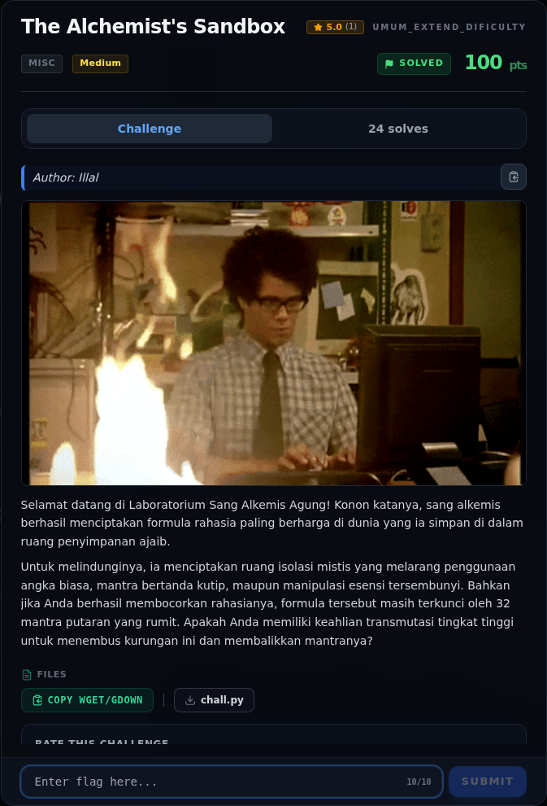

# The Alchemist's Sandbox — Analisis

[← Overview](32-the-alchemists-sandbox.md) · [Index](index.md)

> **Langkah 3/10 — Analisis.** Filter memiliki beberapa lapis:
>
> **Titik penting:** Filter memiliki beberapa lapis:
>
> **Berikutnya:** [Analisis](32-the-alchemists-sandbox-04-analisis-2.md)

## 2.1 Filter AST

Filter memiliki beberapa lapis:

1. **Karakter:** angka `0-9` dan kutip `"`/`'` tidak boleh muncul di string
   ekspresi.
2. **Panjang:** maksimal 1024 karakter.
3. **Node terlarang:** import, lambda, comprehension, f-string.
4. **Atribut privat:** node `ast.Attribute` dengan `attr.startswith("_")`
   ditolak.
5. **Call:** maksimal 2 argumen posisional, tanpa keyword.

Yang tersedia di environment: `getattr`, `chr`, dan `als`
(`_encrypt_vault`).

## 2.2 Celah: `getattr` + nama dinamis

Akses langsung `als.__globals__` ditolak karena `ast.Attribute` dengan
`attr="_..."`. Tetapi:

```python
getattr(als, "__globals__")
```

tidak memakai node `ast.Attribute` sama sekali. Yang perlu dilakukan
hanyalah membangun string `__globals__` tanpa menulis huruf/angka/kutip.

## 2.3 Membangun angka dan karakter

`True` adalah boolean, bukan literal angka, dan nilainya 1. Dengan assignment
expression `:=` dan bit shift:

```python
a = True          # 1
b = a << a        # 2
d = b << a        # 4
e = d << a        # 8
f = e << a        # 16
h = f << a        # 32
j = h << a        # 64
k = j + h         # 96
u = chr(k - a)    # chr(95) = '_'
```

Dari situ:

```text
chr(k+a+b+d)          = chr(103) = 'g'
chr(k+d+e)            = chr(108) = 'l'
chr(k+a+b+d+e)        = chr(111) = 'o'
chr(k+b)              = chr(98)  = 'b'
chr(k+a)              = chr(97)  = 'a'
chr(k+d+e)            = chr(108) = 'l'
chr(k+a+b+f)          = chr(115) = 's'
u + u                 = '__'
```

Sehingga `u+u+...+u+u` = `__globals__`.

Dengan pola yang sama, key `_VAULT_STATE` dibangun:

```text
'_' 'V' 'A' 'U' 'L' 'T' '_' 'S' 'T' 'A' 'T' 'E'
```

### Evidence langkah ini



*Challenge brief asli di platform NFX CTF 2026.*
