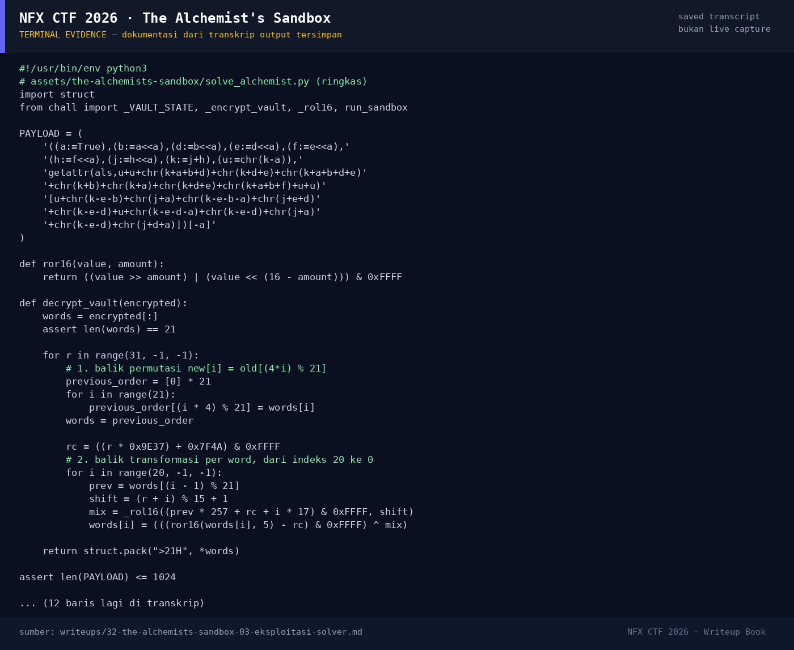

# The Alchemist's Sandbox — Evidence / Bukti

1 screenshot3 transkrip / script

[← Overview](32-the-alchemists-sandbox.md) · [Index](index.md)

## Arsip Evidence

> Semua file di bawah berasal dari folder `assets/the-alchemists-sandbox/`. Screenshot ditempel langsung; file teks/script ditautkan.

### Screenshot

<figure><figcaption>98-terminal-evidence.png</figcaption></figure>

### Transkrip / file pendukung

- [`01-solve-output.txt`](assets/the-alchemists-sandbox/01-solve-output.txt)
- [`chall.py`](assets/the-alchemists-sandbox/chall.py)
- [`solve_alchemist.py`](assets/the-alchemists-sandbox/solve_alchemist.py)

## Tabel Evidence

Semua bukti berada di `writeups/assets/the-alchemists-sandbox/`.

| Bukti | File | Keterangan |
|---|---|---|
| Output solver | `01-solve-output.txt` | Payload PASS, ciphertext, round-trip, flag |
| Source challenge | `chall.py` | Salinan `chall.py` asli |
| Solver | `solve_alchemist.py` | Payload + inverse 32 ronde |