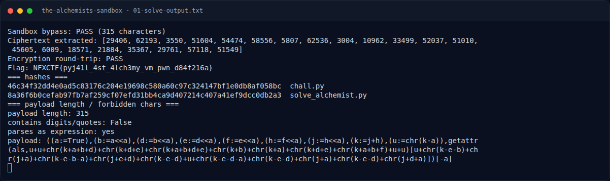
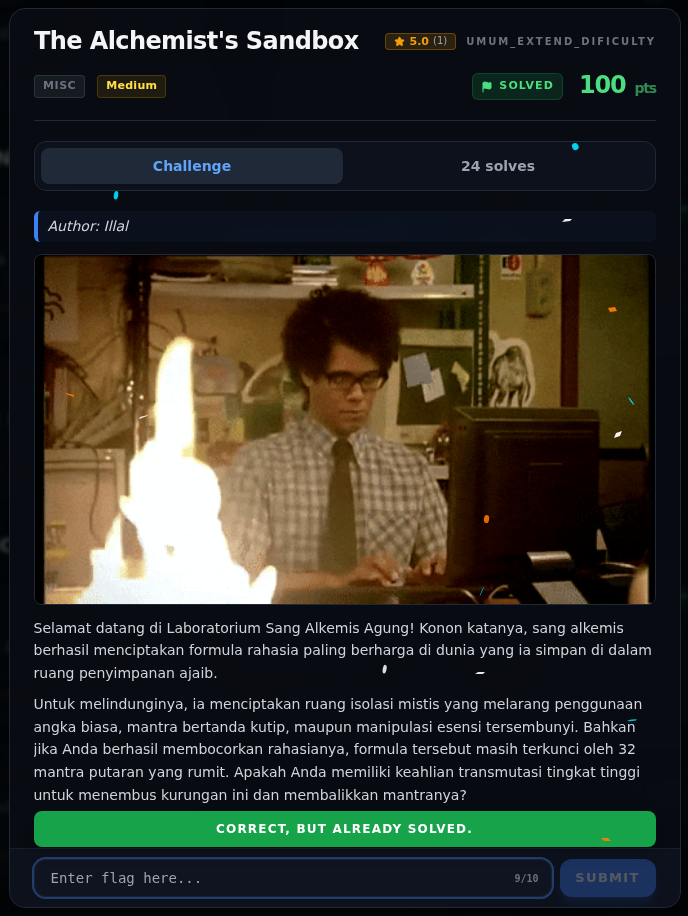

# The Alchemist's Sandbox — Flag & Verifikasi

[← Overview](32-the-alchemists-sandbox.md) · [Index](index.md)

> **Langkah 8/10 — Flag.** Flag
>
> **Titik penting:** NFXCTF{pyj41l_4st_4lch3my_vm_pwn_d84f216a}
>
> **Berikutnya:** [Bukti / Evidence](32-the-alchemists-sandbox-09-bukti-evidence.md)

> **Asal flag.** Flag diperoleh dari langkah exploit/solver yang terdokumentasi, lalu disubmit ke platform.  
> **Tingkat bukti metode.** Terdokumentasi. [Buka Evidence](32-the-alchemists-sandbox-09-bukti-evidence.md)

> **Status metode:** **FULL** — metode utama berhasil direproduksi.  
> **Flag:** `NFXCTF{pyj41l_4st_4lch3my_vm_pwn_d84f216a}`
> **Status:** `VERIFIED`

```text
NFXCTF{pyj41l_4st_4lch3my_vm_pwn_d84f216a}
```

Verifikasi:

- Payload lolos `verify_ast` (tanpa angka/kutip, tanpa node terlarang).
- `run_sandbox(PAYLOAD)` mengembalikan `_VAULT_STATE` yang sama.
- Hasil dekripsi 42 byte.
- `_encrypt_vault(flag) == _VAULT_STATE` (round-trip PASS).
- Flag sama dengan `flags/wave2/The_Alchemists_Sandbox.txt`.

### Terminal evidence (real)



*Terminal evidence (real).*

> **Bukti:** terminal evidence (real).

## Validasi platform (real)



*Screenshot asli dari platform NFX CTF 2026. Platform menjawab
`CORRECT, BUT ALREADY SOLVED.` untuk flag ini.*
