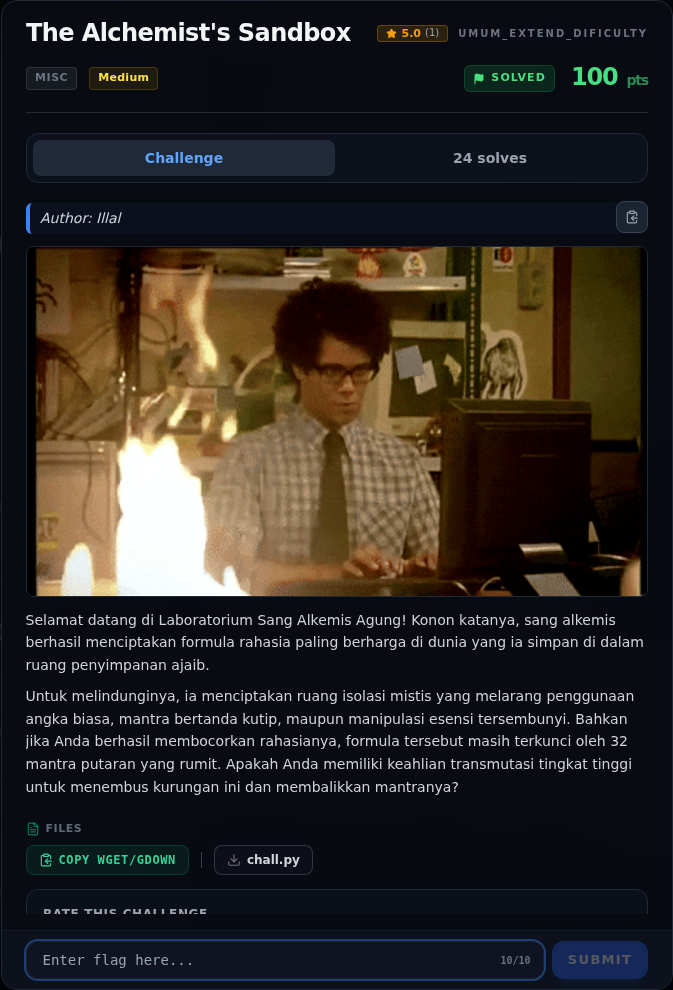
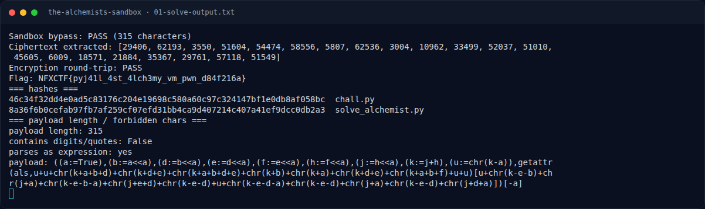

# The Alchemist's Sandbox — Evidence / Bukti

3 screenshot3 transkrip / script

[← Overview](32-the-alchemists-sandbox.md) · [Index](index.md)

> **Langkah 9/10 — Bukti / Evidence.** Semua bukti berada di writeups/assets/the-alchemists-sandbox/.
>
> **Titik penting:** arsip screenshot dan transkrip
>
> **Berikutnya:** [Referensi](32-the-alchemists-sandbox-10-referensi.md)

## Arsip Evidence

> Semua file berasal dari `assets/the-alchemists-sandbox/`. Screenshot platform dan terminal adalah bukti asli dari sesi solve; transkrip mentah tetap ditautkan di bagian bawah.

### Platform

<figure><figcaption>00-challenge-platform.png</figcaption></figure>

*Challenge brief asli di platform NFX CTF 2026.*

<figure><figcaption>Terminal evidence (real)</figcaption></figure>

*Terminal evidence (real).*

### Terminal (arsip sesi)

<figure><figcaption>term-01-solve-output.png</figcaption></figure>

*Terminal evidence — `01-solve-output.txt` (arsip transkrip sesi solve).*

### Transkrip mentah & script

- [`01-solve-output.txt`](assets/the-alchemists-sandbox/01-solve-output.txt)
- [`chall.py`](assets/the-alchemists-sandbox/chall.py)
- [`solve_alchemist.py`](assets/the-alchemists-sandbox/solve_alchemist.py)

## Tabel Evidence

Semua bukti berada di `writeups/assets/the-alchemists-sandbox/`.

| Bukti | File | Keterangan |
|---|---|---|
| Output solver | `01-solve-output.txt` | Payload PASS, ciphertext, round-trip, flag |
| Source challenge | `chall.py` | Salinan `chall.py` asli |
| Solver | `solve_alchemist.py` | Payload + inverse 32 ronde |