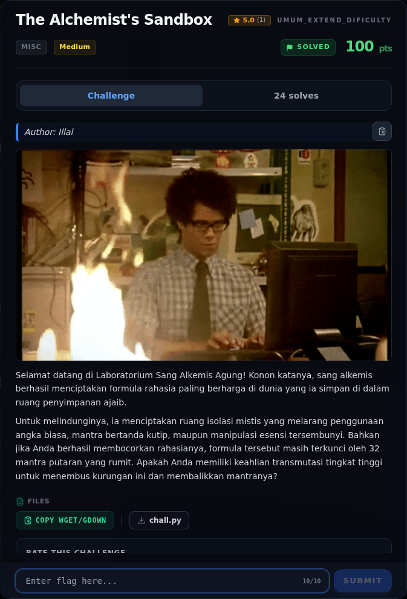

# The Alchemist's Sandbox — Referensi

[← Overview](32-the-alchemists-sandbox.md) · [Index](index.md)

> **Langkah 10/10 — Referensi.** Referensi
>
> **Titik penting:** —
>
> **Selesai.** Kembali ke [Overview](32-the-alchemists-sandbox.md).

- `chall.py` — source challenge.
- `flags/wave2/The_Alchemists_Sandbox.txt` — flag terverifikasi.
- Python `ast` module, assignment expressions (PEP 572), `getattr`,
  rotasi 16-bit.

### Evidence langkah ini

*Challenge brief asli di platform NFX CTF 2026.*
