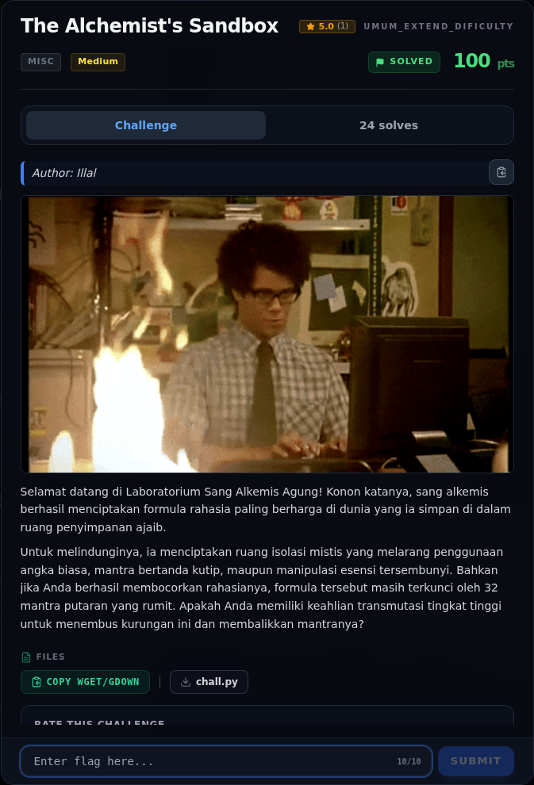
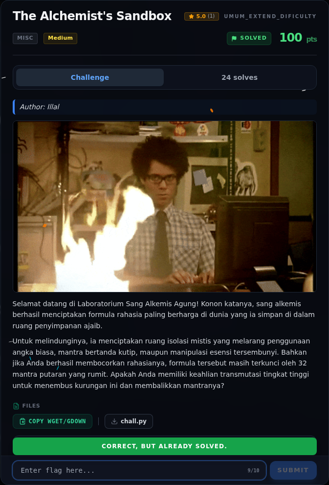

# The Alchemist's Sandbox

Track Umum / Extend · MiscMedium240 poinVERIFIED

| Field | Nilai |
|---|---|
| Event | `umum_Extend` |
| Kategori | `Misc` |
| Difficulty | `Medium` |
| Poin | `240` |
| Author | `Illal` |
| Solves | `14` |
| Tools | python3, git |
| Flag | `NFXCTF{pyj41l_4st_4lch3my_vm_pwn_d84f216a}` |
| Status | `VERIFIED` |

[← Kembali ke Index](index.md)

## Challenge Brief (platform)

*Challenge brief asli di platform NFX CTF 2026.*

## TL;DR

- `chall.py` mengevaluasi ekspresi Python di sandbox AST yang melarang
  angka, tanda kutip, import, lambda, comprehension, f-string, dan atribut
  yang diawali `_`.
- Namun `getattr(als, "__globals__")` bisa dipanggil jika nama atributnya
  dibangun secara dinamis. `als` adalah fungsi `_encrypt_vault`, sehingga
  `als.__globals__["_VAULT_STATE"]` membocorkan ciphertext.
- Payload 315 karakter tanpa angka/kutip membangun `__globals__` dan
  `_VAULT_STATE` dari `True` (1), bit shift, dan `chr`.
- `_VAULT_STATE` berisi 21 word 16-bit (42 byte flag) setelah **32 ronde**
  transformasi XOR/rotasi/permutasi.
- Inverse round dari 31 ke 0 memulihkan plaintext; enkripsi ulang
  memverifikasi hasilnya.
- Flag: `NFXCTF{pyj41l_4st_4lch3my_vm_pwn_d84f216a}`.

Pratinjau evidence. Buka halaman <a href="32-the-alchemists-sandbox-09-bukti-evidence.html">Evidence / Bukti</a> untuk semua screenshot dan transkrip.

## Navigasi Halaman

<a class="nx-page-card" href="32-the-alchemists-sandbox-01-recon.html"><b>Recon</b>Enumerasi target dan bukti awal</a>
<a class="nx-page-card" href="32-the-alchemists-sandbox-02-triage-awal.html"><b>Triage awal</b>Baca bagian ini</a>
<a class="nx-page-card" href="32-the-alchemists-sandbox-03-analisis.html"><b>Analisis</b>Membaca alur dan akar masalah</a>
<a class="nx-page-card" href="32-the-alchemists-sandbox-04-analisis-2.html"><b>Analisis</b>Membaca alur dan akar masalah</a>
<a class="nx-page-card" href="32-the-alchemists-sandbox-05-payload.html"><b>Payload</b>Baca bagian ini</a>
<a class="nx-page-card" href="32-the-alchemists-sandbox-06-solver-lengkap.html"><b>Solver lengkap</b>Langkah exploit dan solver</a>
<a class="nx-page-card" href="32-the-alchemists-sandbox-07-output-asli.html"><b>Output asli</b>Baca bagian ini</a>
<a class="nx-page-card" href="32-the-alchemists-sandbox-08-flag.html"><b>Flag</b>Flag dan verifikasi platform</a>
<a class="nx-page-card" href="32-the-alchemists-sandbox-09-bukti-evidence.html"><b>Bukti / Evidence</b>Screenshot, transkrip, dan artefak</a>
<a class="nx-page-card" href="32-the-alchemists-sandbox-10-referensi.html"><b>Referensi</b>Sumber dan bacaan lanjutan</a>

