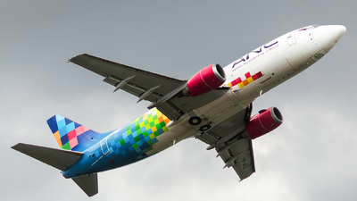

# Fresh Arrival — Jejak Awal

[← Overview](33-fresh-arrival.md) · [Index](index.md)

## 1.1 Deskripsi challenge

> **Author: Ariaf**
>
> Sebuah foto pesawat kargo beredar di grup komunitas tanpa keterangan apa
> pun. Fotonya diambil di Jakarta pada akhir November 2025, kurang dari
> sebulan setelah pesawat ini bergabung dengan maskapai yang tertera di
> badannya.
>
> Pesawat ini bukan barang baru: usianya sudah lebih dari tiga dekade dan
> pernah dioperasikan beberapa maskapai di negara lain.
>
> Tugasmu ada dua:
> 1. Temukan fotografer asli foto ini.
> 2. Telusuri riwayat airframe-nya dan temukan operator PERTAMA yang
>    menerimanya sejak dikirim dari pabrik.
>
> Flag terdiri dari kode IATA 2 huruf, kode ICAO 3 huruf, kota markas
> operator pertama tersebut, dan nama depan fotografer. Semua huruf kecil,
> dipisah underscore.
>
> Format: `NFX{IATA_ICAO_kota_namadepan}`

## 1.2 File / service yang diberikan

| File/Service | Ukuran | Keterangan |
|---|---|---|
| `osint/spotted.jpg` | 68.302 byte | Foto pesawat 400×225, tanpa EXIF kamera |
| `flags/wave2/Fresh_Arrival.NOTES.md` | 2.7 KB | Catatan solve sebelumnya |
| `/tmp/opencode/skywriteups/writeups/06-fresh-arrival.md` | 4.3 KB | Draft writeup sebelumnya |

Hash:

```bash
$ sha256sum osint/spotted.jpg
1b74fef0e79aae45c0a5adc275124f2b996b67547f1a39180451ce9750cf4600  osint/spotted.jpg
```

## 1.3 Environment

- OS: Linux x86-64.
- Tools: `file`, `exiftool`, `sha256sum`, Python 3 (`Pillow`, `numpy`),
  `curl`.
- Service: tidak ada; seluruh challenge berbasis gambar dan sumber publik.
- Sumber publik: Yandex Images, JetPhotos, Wikidata, Wikipedia.

### Evidence langkah ini



*Evidence — `01-spotted.jpg`.*
