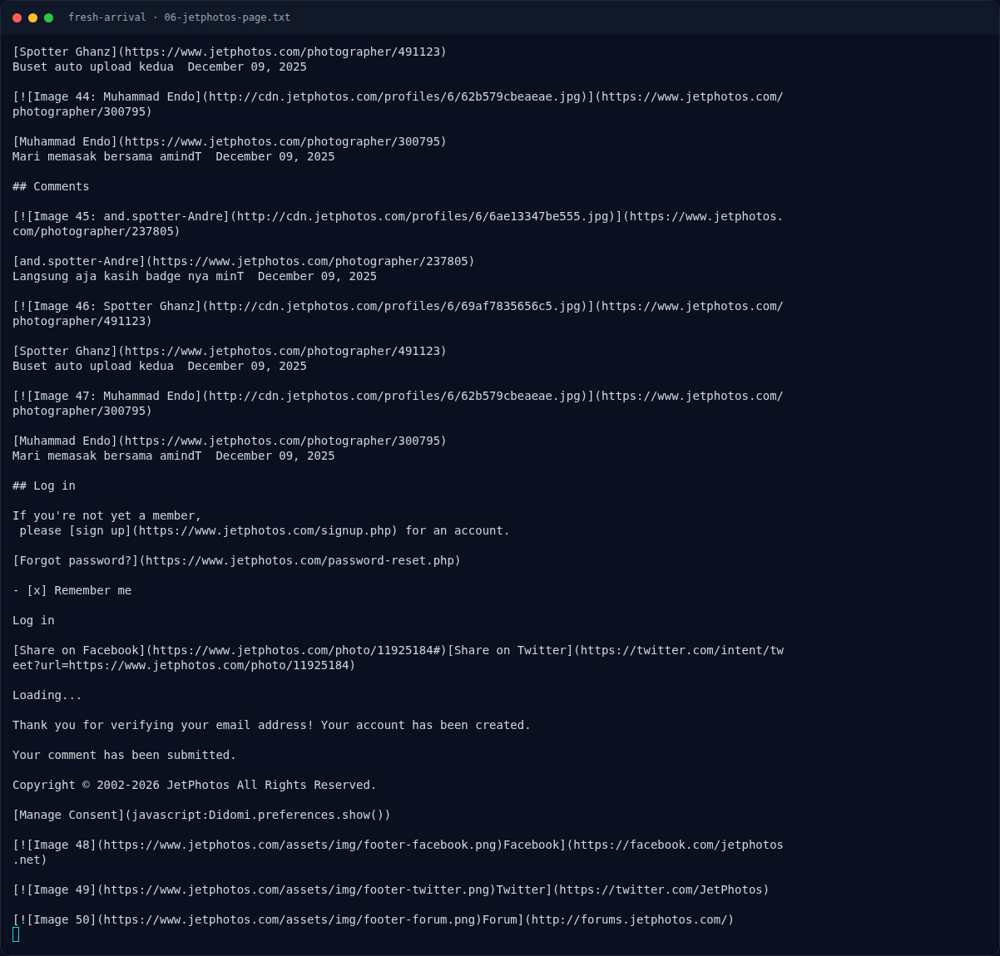
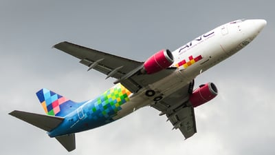

# Fresh Arrival — Analisis Jejak

[← Overview](33-fresh-arrival.md) · [Index](index.md)

> **Langkah 4/8 — Analisis Jejak.** MSN 26854, Boeing 737-341, first flight 28 Mei 1992 (usia >30 tahun saat foto 2025).
>
> **Titik penting:** NFX{IATA_ICAO_kota_namadepan} · NFX{XW_CXH_beijing_raihan}
>
> **Berikutnya:** [Pencarian & Verifikasi](33-fresh-arrival-05-pencarian-verifikasi.md)

## 2.4 Riwayat airframe dan operator pertama

MSN 26854, Boeing 737-341, first flight **28 Mei 1992** (usia >30 tahun saat
foto 2025). Riwayat registrasi/operator (Airfleets/JetPhotos/Cargo Facts):

| Registrasi | Tanggal | Operator |
|---|---|---|
| B-2908 | 1993-04-15 | **China Xinhua Airlines** |
| B-2908 | 2010-04-01 | Yangtze River Express (konversi freighter) |
| B-2908 | 2017-07-07 | Suparna Airlines |
| B-2908 | 2021-04-01 | Central Airlines |
| PK-ADL | 2025-11-08 | Aero Nusantara Cargo (leased from AFG) |

Operator **pertama sejak dikirim dari pabrik**: **China Xinhua Airlines**
(中国新华航空).

JetPhotos serial page juga mengonfirmasi bahwa airframe 26854 pernah
beroperasi sebagai **B-2908 / Central Airlines** dan sekarang **PK-ADL /
Aero Nusantara Cargo**, cocok dengan tabel di atas.

## 2.5 Kode maskapai dan markas

Wikidata Q1073547 (China Xinhua Airlines):

```text
IATA (P229) : XW
ICAO (P230) : CXH
HQ (P159)   : Q956 (Beijing)
```

Wikipedia:

> China Xinhua Airlines was an airline based in **Chaoyang District, Beijing,
> China**. ... Its main bases were Beijing Capital International Airport and
> Tianjin Binhai International Airport.

Jadi:

- IATA: `XW`
- ICAO: `CXH`
- Kota markas: `beijing`
- Nama depan fotografer: `raihan`

## 2.6 Menyusun flag

Format `NFX{IATA_ICAO_kota_namadepan}`, semua huruf kecil, underscore:

```text
XW + CXH + beijing + raihan
= NFX{XW_CXH_beijing_raihan}
```

### Evidence langkah ini



*Terminal evidence — `06-jetphotos-page.txt` (arsip transkrip sesi solve).*



*Evidence — `02-jetphotos-11925184-thumb.jpg`.*

**Berkas mentah langkah ini:**

- [`06-jetphotos-page.txt`](assets/fresh-arrival/06-jetphotos-page.txt)
