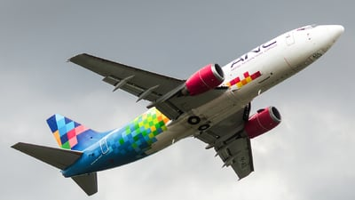
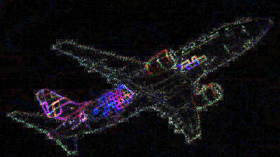

# Fresh Arrival — Evidence / Bukti

[← Overview](33-fresh-arrival.md) · [Index](index.md)

## Arsip Evidence

> Semua file di bawah berasal dari folder `assets/fresh-arrival/`. Screenshot ditempel langsung; file teks/script ditautkan.

### Screenshot

### Transkrip / file pendukung

- [`04-image-compare.txt`](assets/fresh-arrival/04-image-compare.txt)
- [`05-wikidata-xinhua.txt`](assets/fresh-arrival/05-wikidata-xinhua.txt)
- [`06-jetphotos-page.txt`](assets/fresh-arrival/06-jetphotos-page.txt)
- [`07-hashes.txt`](assets/fresh-arrival/07-hashes.txt)

## Tabel Evidence

Semua bukti berada di `writeups/assets/fresh-arrival/`.

| Bukti | File | Keterangan |
|---|---|---|
| Foto challenge | `01-spotted.jpg` | 400×225, hash `1b74fef0...` |
| Thumbnail JetPhotos | `02-jetphotos-11925184-thumb.jpg` | Foto yang sama, CDN JetPhotos |
| Diff piksel | `03-pixel-diff-x8.png` | Selisih piksel diperbesar 8× |
| Perbandingan | `04-image-compare.txt` | Ukuran, hash, MAE, jumlah piksel identik |
| Wikidata Xinhua | `05-wikidata-xinhua.txt` | IATA `XW`, ICAO `CXH`, HQ Beijing |
| Halaman JetPhotos | `06-jetphotos-page.txt` | Metadata fotografer, tanggal, lokasi, MSN |
| Hash | `07-hashes.txt` | SHA-256 kedua gambar |
