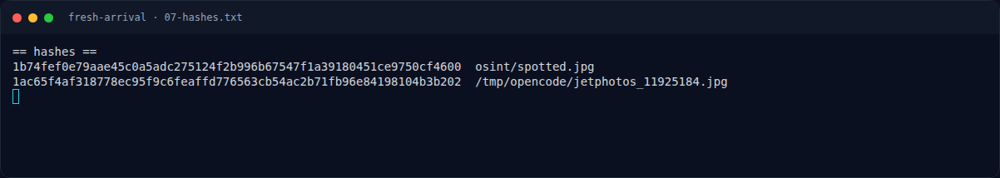
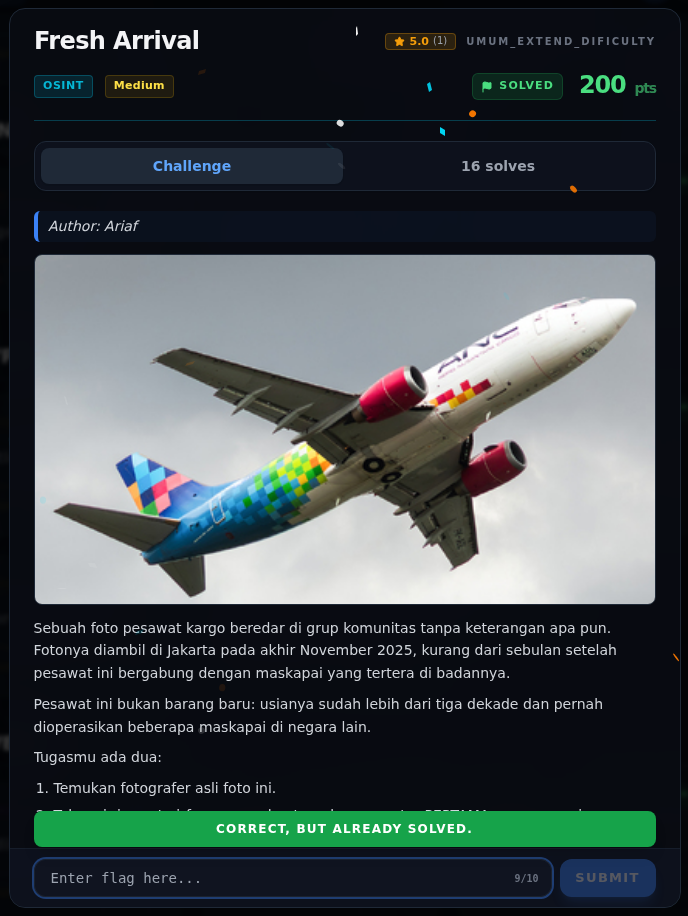

# Fresh Arrival — Flag & Verifikasi

[← Overview](33-fresh-arrival.md) · [Index](index.md)

> **Langkah 6/8 — Flag.** Flag ini sudah disubmit lewat web platform dan diterima.
>
> **Titik penting:** NFX{XW_CXH_beijing_raihan}
>
> **Berikutnya:** [Bukti / Evidence](33-fresh-arrival-07-bukti-evidence.md)

> **Asal flag.** Flag dari JetPhotos + Wikidata, lalu disubmit lewat web.  
> **Tingkat bukti metode.** Terdokumentasi. [Buka Evidence](33-fresh-arrival-07-bukti-evidence.md)

> **Status metode:** **FULL** — metode utama berhasil direproduksi.  
> **Flag:** `NFX{XW_CXH_beijing_raihan}`
> **Status:** `VERIFIED`

```text
NFX{XW_CXH_beijing_raihan}
```

Verifikasi:

```text
JetPhotos photo ID : 11925184
Photographer       : Raihan Al Faris  -> raihan
Aircraft           : Boeing 737-341(SF), MSN 26854
First operator     : China Xinhua Airlines
IATA               : XW
ICAO               : CXH
HQ                 : Beijing
```

Flag sudah disubmit lewat web platform dan diterima (`CORRECT, BUT ALREADY SOLVED.`).

### Terminal evidence (real)



*Terminal evidence (real).*

> **Bukti:** terminal evidence (real).

## Validasi platform (real)



*Screenshot asli dari platform NFX CTF 2026. Platform menjawab
`CORRECT, BUT ALREADY SOLVED.` untuk flag ini.*
