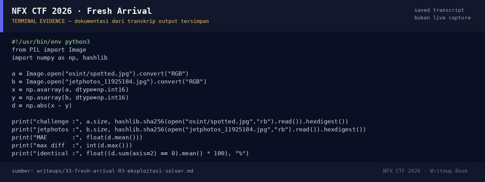

# Fresh Arrival

Track Umum / Extend · OsintMedium340 poinVERIFIED

| Field | Nilai |
|---|---|
| Event | `umum_Extend` |
| Kategori | `Osint` |
| Difficulty | `Medium` |
| Poin | `340` |
| Author | `Ariaf` |
| Solves | `9` |
| Tools | curl, python3, exiftool |
| Flag | `NFX{XW_CXH_beijing_raihan}` |
| Status | `VERIFIED` |

[← Kembali ke Index](index.md)

## TL;DR

- Foto challenge adalah **Boeing 737-341(SF)**, registrasi **PK-ADL**,
  MSN **26854**, milik **Aero Nusantara Cargo**.
- Foto aslinya ada di JetPhotos, photo ID **11925184**, diambil
  **26 November 2025** di **Jakarta Halim Perdanakusuma (WIHH)** oleh
  **Raihan Al Faris**.
- Thumbnail JetPhotos 400×225 dibandingkan piksel-per-piksel dengan
  `spotted.jpg`: ukuran sama, **MAE ≈ 2,2/255** — hanya re-encoding CDN.
- Riwayat airframe: MSN 26854 pertama diterima oleh **China Xinhua Airlines**
  (B-2908), lalu Yangtze River Express, Suparna Airlines, Central Airlines,
  dan terakhir PK-ADL/Aero Nusantara Cargo.
- China Xinhua Airlines: IATA **XW**, ICAO **CXH**, markas **Beijing**.
- Flag: `NFX{XW_CXH_beijing_raihan}`.

Pratinjau evidence. Buka halaman <a href="33-fresh-arrival-05-bukti-evidence.html">Evidence / Bukti</a> untuk semua screenshot dan transkrip.

## Navigasi Halaman

<a class="nx-page-card" href="33-fresh-arrival-01-recon.html"><b>Recon</b>Enumerasi target dan bukti awal</a>
<a class="nx-page-card" href="33-fresh-arrival-02-analisis.html"><b>Analisis</b>Membaca alur dan akar masalah</a>
<a class="nx-page-card" href="33-fresh-arrival-03-eksploitasi-solver.html"><b>Eksploitasi / Solver</b>Langkah exploit dan solver</a>
<a class="nx-page-card" href="33-fresh-arrival-04-flag.html"><b>Flag</b>Flag dan verifikasi platform</a>
<a class="nx-page-card" href="33-fresh-arrival-05-bukti-evidence.html"><b>Bukti / Evidence</b>Screenshot, transkrip, dan artefak</a>
<a class="nx-page-card" href="33-fresh-arrival-06-referensi.html"><b>Referensi</b>Sumber dan bacaan lanjutan</a>

