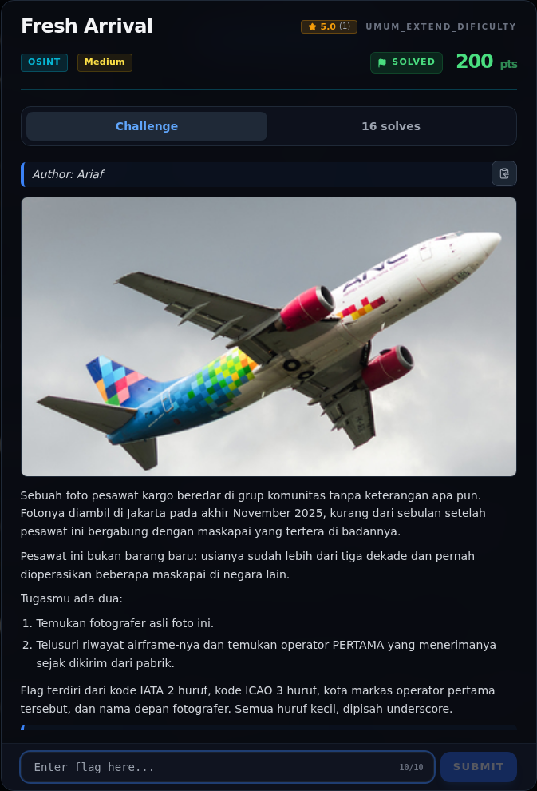

# Fresh Arrival

Track Umum / Extend · OsintMedium340 poinVERIFIED

| Field | Nilai |
|---|---|
| Event | `umum_Extend` |
| Kategori | `Osint` |
| Difficulty | `Medium` |
| Poin | `340` |
| Author | `Ariaf` |
| Solves | `9` |
| Tools | curl, python3, exiftool |
| Flag | `NFX{XW_CXH_beijing_raihan}` |
| Status | `VERIFIED` |

[← Kembali ke Index](index.md)

## Challenge Brief (platform)

*Challenge brief asli di platform NFX CTF 2026.*

## Cerita singkat

Jadi ceritanya gini. foto challenge adalah **Boeing 737-341(SF)**, registrasi **PK-ADL**, MSN **26854**, milik **Aero Nusantara Cargo**. Terus, foto aslinya ada di JetPhotos, photo ID **11925184**, diambil **26 November 2025** di **Jakarta Halim Perdanakusuma (WIHH)** oleh **Raihan Al Faris**. Lalu, thumbnail JetPhotos 400×225 dibandingkan piksel-per-piksel dengan `spotted.jpg`: ukuran sama, **MAE ≈ 2,2/255** — hanya re-encoding CDN. Nah, dari situ kita bisa sampai ke flag dan bukti submit-nya.

## Alur & Titik Penting

| # | Langkah | Titik penting | Buka |
|---:|---|---|---|
| 1 | Jejak Awal | sha256sum osint/spotted.jpg | [Buka](33-fresh-arrival-01-jejak-awal.md) |
| 2 | Triage awal | file osint/spotted.jpg | [Buka](33-fresh-arrival-02-triage-awal.md) |
| 3 | Analisis Jejak | https://www.jetphotos.com/photo/11925184 | [Buka](33-fresh-arrival-03-analisis-jejak.md) |
| 4 | Analisis Jejak | NFX{IATA_ICAO_kota_namadepan} | [Buka](33-fresh-arrival-04-analisis-jejak-2.md) |
| 5 | Pencarian & Verifikasi | — | [Buka](33-fresh-arrival-05-pencarian-verifikasi.md) |
| 6 | Flag | NFX{XW_CXH_beijing_raihan} | [Buka](33-fresh-arrival-06-flag.md) |
| 7 | Bukti / Evidence | arsip screenshot dan transkrip | [Buka](33-fresh-arrival-07-bukti-evidence.md) |
| 8 | Referensi | https://www.jetphotos.com/photo/11925184 | [Buka](33-fresh-arrival-08-referensi.md) |

## TL;DR

- Foto challenge adalah **Boeing 737-341(SF)**, registrasi **PK-ADL**,
  MSN **26854**, milik **Aero Nusantara Cargo**.
- Foto aslinya ada di JetPhotos, photo ID **11925184**, diambil
  **26 November 2025** di **Jakarta Halim Perdanakusuma (WIHH)** oleh
  **Raihan Al Faris**.
- Thumbnail JetPhotos 400×225 dibandingkan piksel-per-piksel dengan
  `spotted.jpg`: ukuran sama, **MAE ≈ 2,2/255** — hanya re-encoding CDN.
- Riwayat airframe: MSN 26854 pertama diterima oleh **China Xinhua Airlines**
  (B-2908), lalu Yangtze River Express, Suparna Airlines, Central Airlines,
  dan terakhir PK-ADL/Aero Nusantara Cargo.
- China Xinhua Airlines: IATA **XW**, ICAO **CXH**, markas **Beijing**.
- Flag verified lewat submit web: `NFX{XW_CXH_beijing_raihan}`.

Pratinjau evidence. Buka halaman <a href="33-fresh-arrival-07-bukti-evidence.html">Evidence / Bukti</a> untuk semua screenshot dan transkrip.

## Navigasi Halaman

<a class="nx-page-card" href="33-fresh-arrival-01-jejak-awal.html"><b>Jejak Awal</b>Baca bagian ini</a>
<a class="nx-page-card" href="33-fresh-arrival-02-triage-awal.html"><b>Triage awal</b>Baca bagian ini</a>
<a class="nx-page-card" href="33-fresh-arrival-03-analisis-jejak.html"><b>Analisis Jejak</b>Membaca alur dan akar masalah</a>
<a class="nx-page-card" href="33-fresh-arrival-04-analisis-jejak-2.html"><b>Analisis Jejak</b>Membaca alur dan akar masalah</a>
<a class="nx-page-card" href="33-fresh-arrival-05-pencarian-verifikasi.html"><b>Pencarian &amp; Verifikasi</b>Baca bagian ini</a>
<a class="nx-page-card" href="33-fresh-arrival-06-flag.html"><b>Flag</b>Flag dan status verifikasi</a>
<a class="nx-page-card" href="33-fresh-arrival-07-bukti-evidence.html"><b>Bukti / Evidence</b>Screenshot, transkrip, dan artefak</a>
<a class="nx-page-card" href="33-fresh-arrival-08-referensi.html"><b>Referensi</b>Sumber dan bacaan lanjutan</a>

