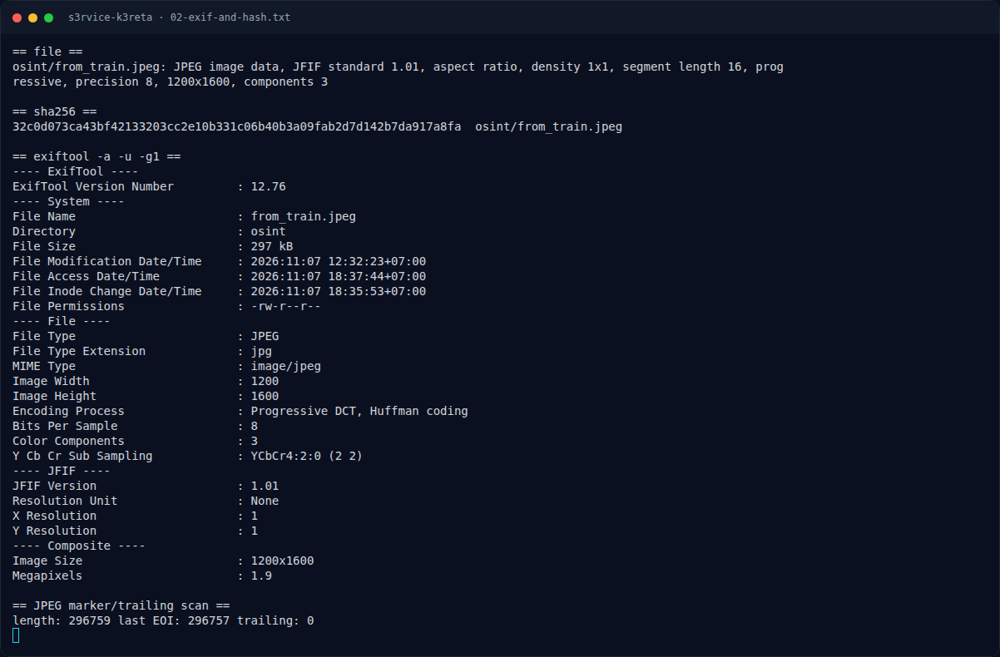

# S3rvice K3reta — Analisis Jejak

[← Overview](34-s3rvice-k3reta.md) · [Index](index.md)

## 2.1 Membaca gambar

Elemen visual utama:

- Foto diambil dari **kereta yang berada di atas viaduk/embankment**;
  terlihat atap rumah dan deretan polybag putih di bawah.
- Latar tengah: **sawah** dan kebun di lembah.
- Latar jauh: **kompleks perumahan** dengan atap gelap dan dinding putih,
  bangunan besar berwarna putih, serta **tower transmisi** dan tower
  telekomunikasi.
- Langit biru dengan awan; matahari rendah (pagi/sore).

Kombinasi “viaduk kereta + sawah + perumahan lereng + tower transmisi” cocok
dengan jalur KRL Bogor Line di petak **Cilebut–Bojong Gede**, Kabupaten
Bogor. Jalur ini berada di atas tebing/embankment, dengan sawah dan
perumahan di sekitarnya.

## 2.2 Menentukan kejadian

Dari konteks lokasi dan Q&A yang sudah diketahui, kejadiannya adalah
**tanah longsor tebingan rel kereta** di:

```text
KM 45+4/5 (piket 400-500)
antara Stasiun Cilebut dan Stasiun Bojong Gede
Rabu, 21 November 2012, sekitar pukul 16.30–17.50 WIB
```

Dampak yang diberitakan:

- Rel sepanjang **±200 meter** amblas/menggantung.
- **4 tiang listrik aliran atas (LAA)** roboh.
- **19–22 rumah** warga tertimbun/rusak.
- **98 perjalanan** KA dari Stasiun Bogor dibatalkan.
- Tidak ada korban jiwa; warga diungsikan.
- Perbaikan diperkirakan **21 hari**.

### Evidence langkah ini



*Terminal evidence — `02-exif-and-hash.txt` (arsip transkrip sesi solve).*
