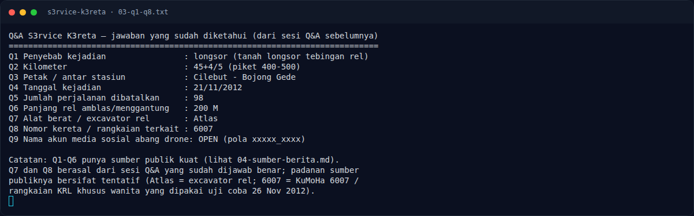

# S3rvice K3reta — Q1–Q13: jawaban dan verifikasi

[← Overview](34-s3rvice-k3reta.md) · [Index](index.md)

> **Langkah 3/9 — Q1–Q13: jawaban dan verifikasi.** Kutipan sumber penting:
>
> **Titik penting:** Kutipan sumber penting:
>
> **Berikutnya:** [Analisis Jejak](34-s3rvice-k3reta-04-analisis-jejak-2.md)

## 2.3 Q1–Q13: jawaban dan verifikasi

| No | Pertanyaan (inti) | Jawaban | Sumber / status |
|---|---|---|---|
| Q1 | Penyebab kejadian | **longsor** | dephub, investor.id, rmol — kuat |
| Q2 | Kilometer | **45+4/5** | investor.id, rmol — kuat |
| Q3 | Petak / antar stasiun | **Cilebut - Bojong Gede** | dephub, investor.id, rmol — kuat |
| Q4 | Tanggal | **21/11/2012** | dephub, rmol — kuat |
| Q5 | Jumlah perjalanan dibatalkan | **98** | rmol, republika — kuat |
| Q6 | Panjang rel amblas | **200 M** | investor.id, rmol, republika — kuat |
| Q7 | Alat berat / excavator rel | **Atlas** | Q&A benar; sumber publik tentatif |
| Q8 | Nomor kereta / rangkaian | **6007** | Q&A benar; sumber publik tentatif |
| Q9 | Akun media sosial “abang drone” | **fandi_8510** | post TikTok `@fandi_8510` |
| Q10 | Tanggal post | **01/02/2026** | timestamp post |
| Q11 | Tempat servis favorit | **Rofi Servis Drone Bogor** | `@rofi_servis` |
| Q12 | Plus Code tempat servis | **7R73+FM7** | Google Maps Ciburuy/Cigombong |
| Q13 | Nama YouTube | **RofiServis** | channel YouTube tempat servis |

Kutipan sumber penting:

```text
dephub.go.id (12/12/2012):
"berhati-hati pada saat melintasi KM 45 antara Stasiun Cilebut dengan
Stasiun Bojonggede."
"peristiwa longsor terjadi pada Rabu 21 November 2012."

investor.id / Antara (22/11/2012):
"longsor tebing ... di antara Stasiun Cilebut dan Bojonggede tepatnya di
kilometer 45+4/5 (petir 400-500)"
"rel KA sepanjang kurang lebih 200 meter amblas dan empat tiang listrik
aliran atas roboh, dan menimbun 19 rumah warga"

rmol.id (22/11/2012):
"dibatalkannya 98 perjalanan rute KA Bogor-Jakarta."
"rel sepanjang 200 meter 'menggantung'."
```

### Evidence langkah ini



*Terminal evidence — `03-q1-q8.txt` (arsip transkrip sesi solve).*

**Berkas mentah langkah ini:**

- [`03-q1-q8.txt`](assets/s3rvice-k3reta/03-q1-q8.txt)
