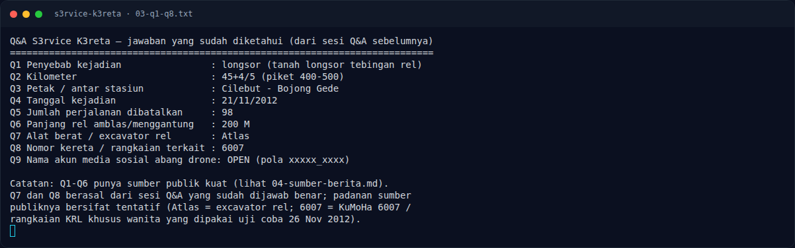

# S3rvice K3reta — Analisis Jejak

[← Overview](34-s3rvice-k3reta.md) · [Index](index.md)

## 2.4 Q7 “Atlas” dan Q8 “6007”

Dua jawaban ini berasal dari sesi Q&A yang sudah dijawab benar. Padanan
sumber publiknya belum 100% terkonfirmasi:

- **Atlas**: Atlas memproduksi **excavator rel** (mis. Atlas 1604 ZW).
  Foto Tempo 25 November 2012 menampilkan “kereta lokomotif ekskavator”
  saat uji coba jalur pascalongsor, sehingga “Atlas” masuk akal sebagai
  alat berat/excavator rel yang dipakai di lokasi.
- **6007**: `KuMoHa 6007` adalah kereta terakhir dalam formasi 6 kereta
  Tokyo Metro/Toei 6000. Rangkaian khusus wanita yang diuji coba pada
  26 November 2012 menggunakan formasi yang berakhiran `KuMoHa 6007`
  (Wikipedia). Ini kandidat kuat untuk “nomor kereta/rangkaian”, tetapi
  hubungan langsung dengan uji coba 26 November 2012 belum dikonfirmasi
  penuh.

Karena Q7/Q8 sudah dinyatakan benar pada Q&A, writeup ini mencatatnya
sebagai jawaban yang diketahui, bukan sebagai tebakan baru.

## 2.5 Reverse image search

Karena metadata kosong, dilakukan reverse image search:

- **Yandex Images** (upload file) mengembalikan “similar images” generik
  (sawah, desa, Bali, Filipina) dan **tidak ada situs sumber** yang cocok.
- **Google Lens** diblokir dari environment ini (captcha/unusual traffic).
- **Bing Visual Search** menolak URL gambar eksternal.

Kesimpulan sementara: gambar tidak terindeks sebagai foto publik, atau
merupakan screenshot/AI-generated yang tidak punya sumber langsung. Ini
membuat Q9 tidak bisa diselesaikan hanya dengan reverse image search;
harus lewat pencarian kontekstual (video drone di lokasi yang sama) dan
verifikasi akun media sosial.

### Evidence langkah ini

*Terminal evidence — `03-q1-q8.txt` (arsip transkrip sesi solve).*

**Berkas mentah langkah ini:**

- [`03-q1-q8.txt`](assets/s3rvice-k3reta/03-q1-q8.txt)
