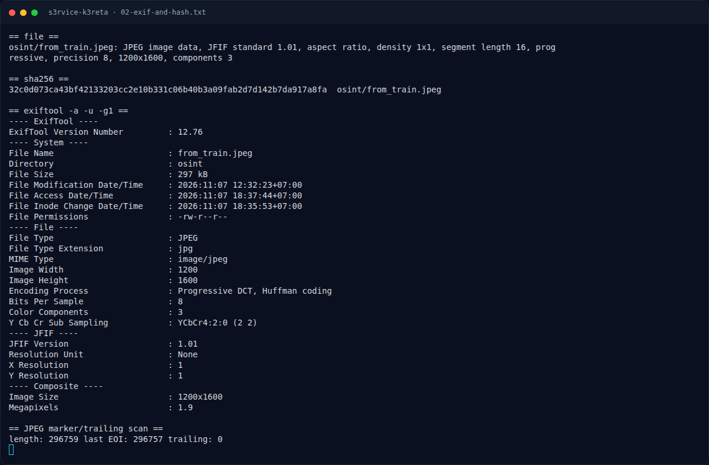
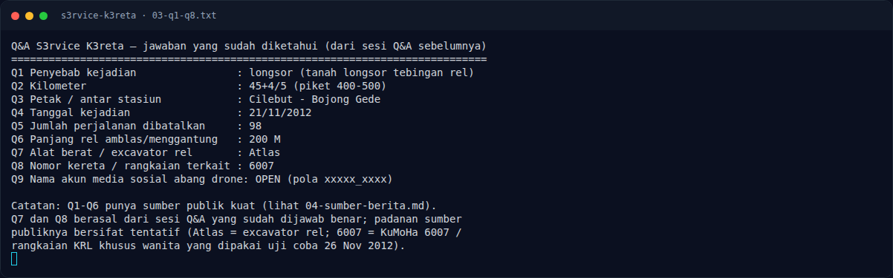

# S3rvice K3reta — Q9–Q13: dari post TikTok ke Plus Code

[← Overview](34-s3rvice-k3reta.md) · [Index](index.md)

## 2.6 Q9–Q13: dari post TikTok ke Plus Code

Sumber yang dimaksud ternyata **post TikTok `@fandi_8510`** (display name
`Fandi27`, bio “Bogor | DJI Drone”), dengan caption:

> “longsoran Cilebut … In 2012 there was a big landslide here, the journey of
> the KRL was paralyzed, and now it can be passed at maximum speed.”
> `#commuterline #djidrone #explorebogor #bojonggede #cilebut`

Tanggal post yang terlihat: **1 Februari 2026** (`01/02/2026`).

| No | Pertanyaan | Jawaban | Bukti |
|---|---|---|---|
| Q9 | Nama akun media sosial abang drone? `(xxxxx_xxxx)` | **`fandi_8510`** | handle TikTok `@fandi_8510`; pola 5 huruf + `_` + 4 digit |
| Q10 | Kapan postingan abang itu di-post? `(xx/xx/xxxx)` | **`01/02/2026`** | timestamp post TikTok |
| Q11 | Apa nama tempat servis favoritnya? `(Xxxx Xxxxxx Xxxxx Xxxxx)` | **`Rofi Servis Drone Bogor`** | bio/repost `@rofi_servis`; caption “servis drone Bogor” |
| Q12 | Apa Plus Code tempat tersebut? `(XXXX+XXX)` | **`7R73+FM7`** | Google Maps “Toko Rofi Servis, Servis Drone, Servis HP”, Ciburuy/Cigombong; short code `7R73+FM`, presisi 11 = `7R73+FM7` |
| Q13 | Nama YouTube dia? `(XxxxXxxxxx)` | **`RofiServis`** | channel YouTube tempat servis; pola 4+6 |

**Flag final:**

```text
NFX{Dr0n3_T3rb41k_T3mp4t_S3rv1c3_T3rb41k_J4uh_B4ng3T_BTW_B4ng_R0f1_K3r3n_S3rb4_b1s4}
```

Diverifikasi lewat `submit_sub_challenges` / `get_sub_challenges` (semua
Q1–Q13 `true`) dan disubmit ke platform: **`Correct! +480 points.`**

### Evidence langkah ini



*Terminal evidence — `02-exif-and-hash.txt` (arsip transkrip sesi solve).*



*Terminal evidence — `03-q1-q8.txt` (arsip transkrip sesi solve).*

**Berkas mentah langkah ini:**

- [`02-exif-and-hash.txt`](assets/s3rvice-k3reta/02-exif-and-hash.txt)
- [`03-q1-q8.txt`](assets/s3rvice-k3reta/03-q1-q8.txt)
