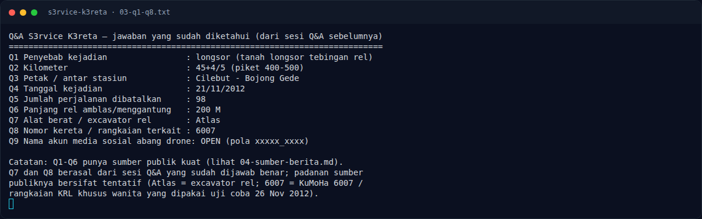
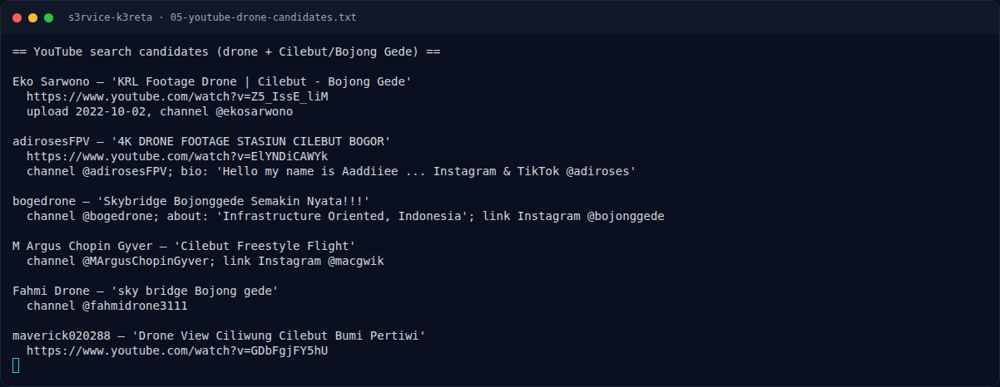

# S3rvice K3reta — Pencarian & Verifikasi

[← Overview](34-s3rvice-k3reta.md) · [Index](index.md)

> **Langkah 6/9 — Pencarian & Verifikasi.** Semua jawaban diverifikasi lewat oracle sub-challenge (true) dan platform menerima flag.
>
> **Titik penting:** python3 - <<'EOF' · https://www.youtube.com/results?search_query="
>
> **Berikutnya:** [Flag](34-s3rvice-k3reta-07-flag.md)

### 3.1 Strategi

1. Baca gambar, tentukan lokasi (Cilebut–Bojong Gede).
2. Cari kejadian di lokasi itu → longsor 21 November 2012.
3. Verifikasi Q1–Q6 dari berita publik.
4. Catat Q7–Q8 dari Q&A yang sudah benar.
5. Untuk Q9, telusuri video drone di lokasi yang sama, lalu akun media
   sosial pilot-nya.

### 3.2 Pencarian video drone (contoh perintah)

```bash
# Query YouTube yang dipakai
# "cilebut drone", "bojong gede drone", "longsor cilebut",
# "krl cilebut", "cilebut dari udara", "cilebut bojong gede drone"

python3 - <<'EOF'
import urllib.request, urllib.parse, re
q = "cilebut drone"
url = "https://www.youtube.com/results?search_query=" + urllib.parse.quote(q)
req = urllib.request.Request(url, headers={"User-Agent": "Mozilla/5.0"})
html = urllib.request.urlopen(req, timeout=30).read().decode("utf-8", "replace")
for vid, title in re.findall(r'"videoId":"([\w-]{11})".*?"title":\{"runs":\[\{"text":"(.*?)"\}\]', html):
    print(vid, title)
EOF
```

Contoh hasil:

```text
ElYNDiCAWYk | 4K DRONE FOOTAGE STASIUN CILEBUT BOGOR
Z5_IssE_liM | KRL Footage Drone | Cilebut - Bojong Gede
GDbFgjFY5hU | Drone View Ciliwung Cilebut Bumi Pertiwi
```

### 3.3 Status Q9–Q13

```text
Q9  = fandi_8510
Q10 = 01/02/2026
Q11 = Rofi Servis Drone Bogor
Q12 = 7R73+FM7
Q13 = RofiServis
```

Semua jawaban diverifikasi lewat oracle sub-challenge (`true`) dan platform
menerima flag.

### Evidence langkah ini



*Terminal evidence — `03-q1-q8.txt` (arsip transkrip sesi solve).*



*Terminal evidence — `05-youtube-drone-candidates.txt` (arsip transkrip sesi solve).*

**Berkas mentah langkah ini:**

- [`03-q1-q8.txt`](assets/s3rvice-k3reta/03-q1-q8.txt)
- [`05-youtube-drone-candidates.txt`](assets/s3rvice-k3reta/05-youtube-drone-candidates.txt)
