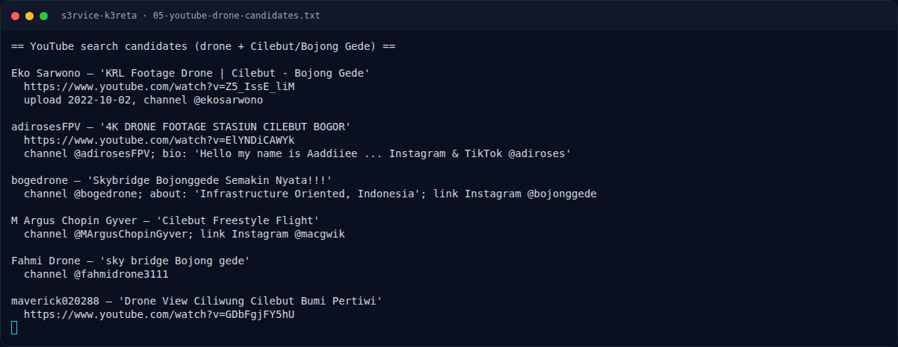
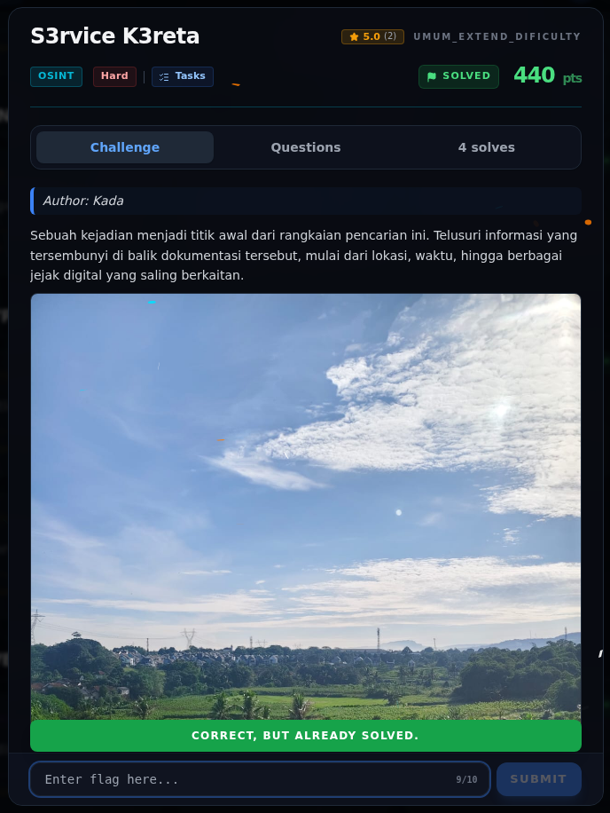

# S3rvice K3reta — Flag & Verifikasi

[← Overview](34-s3rvice-k3reta.md) · [Index](index.md)

> **Langkah 7/9 — Flag.** Status: VERIFIED — Correct!
>
> **Titik penting:** NFX{Dr0n3_T3rb41k_T3mp4t_S3rv1c3_T3rb41k_J4uh_B4ng3T_BTW_B4ng_R0f1_K3r3n_S3rb4_b1s4}
>
> **Berikutnya:** [Bukti / Evidence](34-s3rvice-k3reta-08-bukti-evidence.md)

> **Asal flag.** Flag diperoleh dari langkah exploit/solver yang terdokumentasi, lalu disubmit ke platform.  
> **Tingkat bukti metode.** Terdokumentasi. [Buka Evidence](34-s3rvice-k3reta-08-bukti-evidence.md)

> **Status metode:** **FULL** — metode utama berhasil direproduksi.  
> **Flag:** `NFX{Dr0n3_T3rb41k_T3mp4t_S3rv1c3_T3rb41k_J4uh_B4ng3T_BTW_B4ng_R0f1_K3r3n_S3rb4_b1s4}`
> **Status:** `VERIFIED`

```text
NFX{Dr0n3_T3rb41k_T3mp4t_S3rv1c3_T3rb41k_J4uh_B4ng3T_BTW_B4ng_R0f1_K3r3n_S3rb4_b1s4}
```

Status: **VERIFIED** — `Correct! +480 points.`

### Terminal evidence (real)



*Terminal evidence (real).*

> **Bukti:** terminal evidence (real).

## Validasi platform (real)



*Screenshot asli dari platform NFX CTF 2026. Platform menjawab
`CORRECT, BUT ALREADY SOLVED.` untuk flag ini.*
