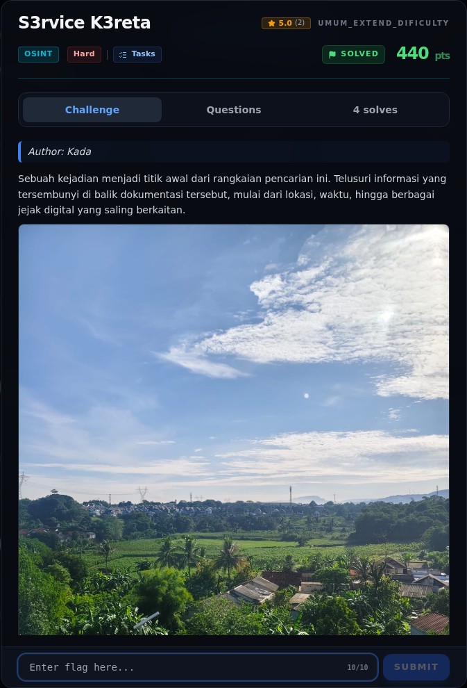
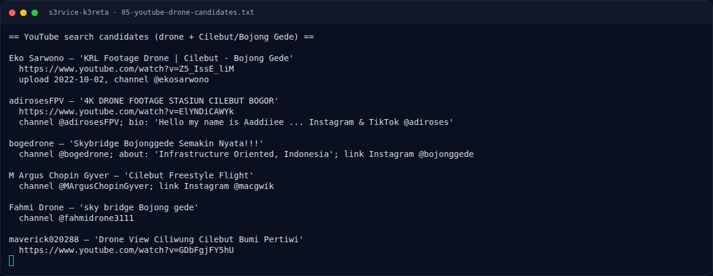
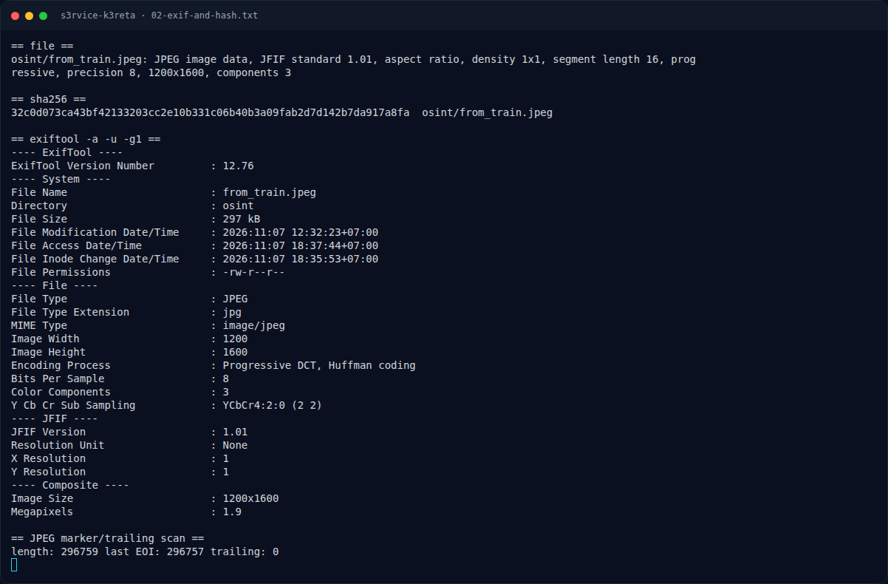
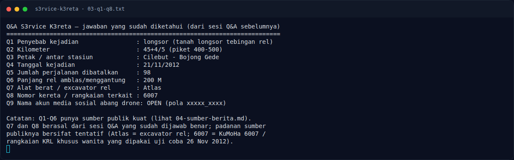
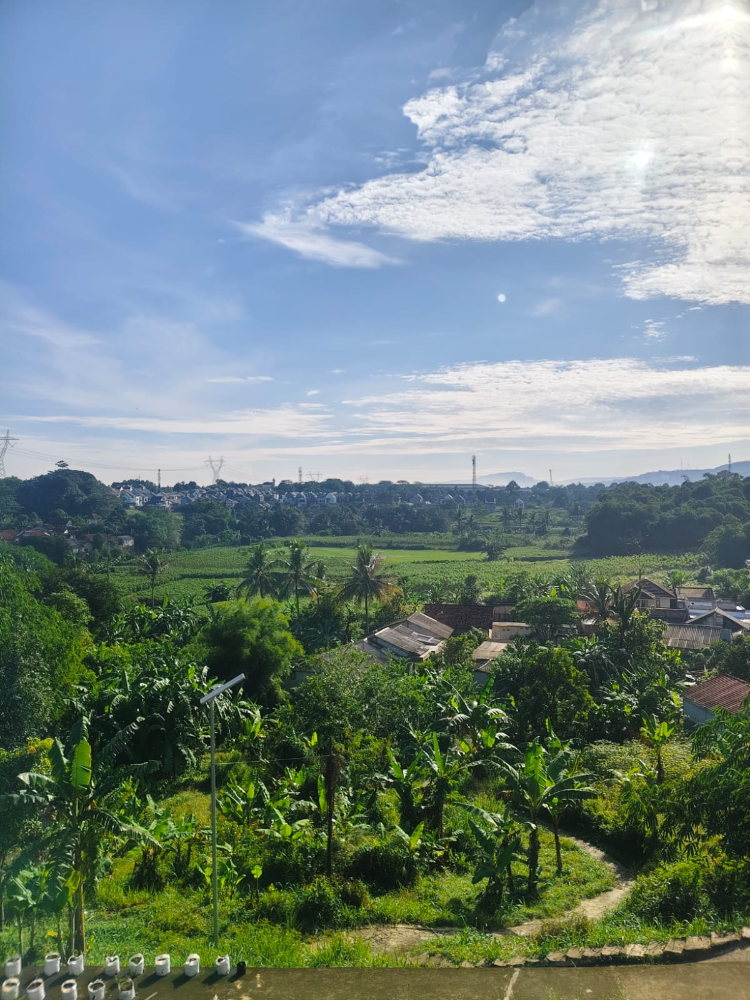
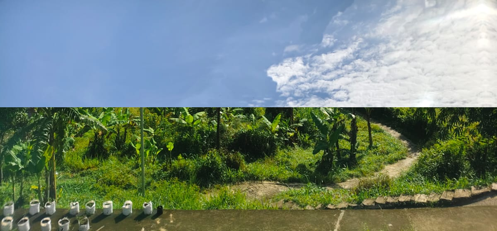
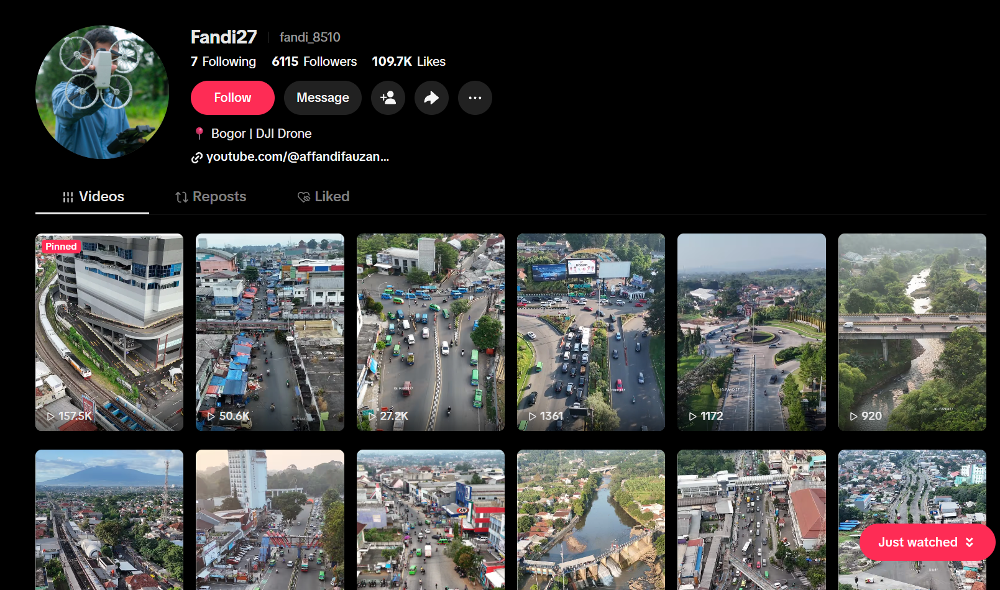
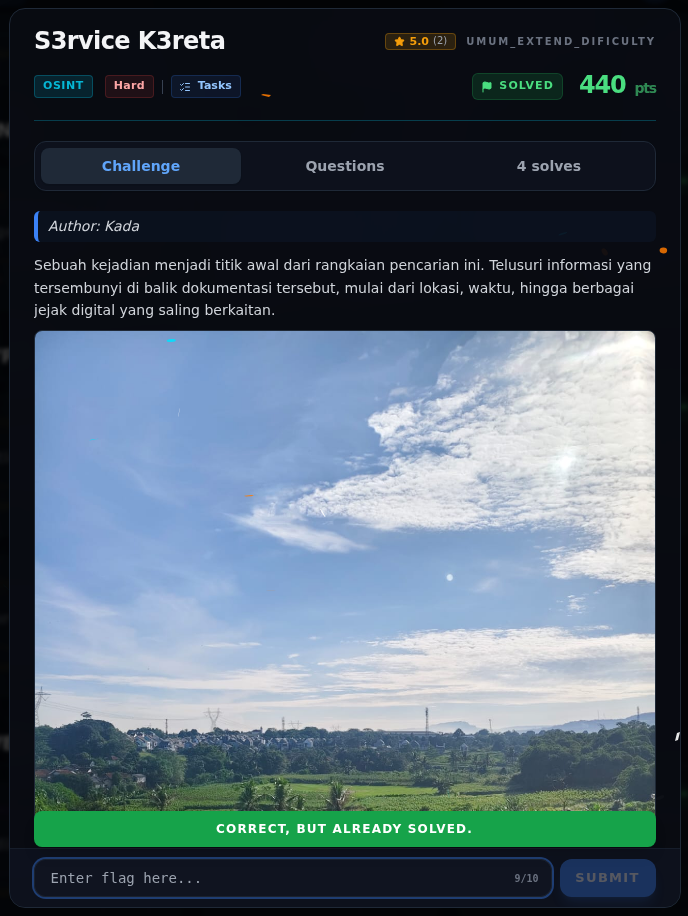

# S3rvice K3reta — Evidence / Bukti

8 screenshot4 transkrip / script

[← Overview](34-s3rvice-k3reta.md) · [Index](index.md)

> **Langkah 8/9 — Bukti / Evidence.** Semua bukti berada di docs/assets/s3rvice-k3reta/.
>
> **Titik penting:** arsip screenshot dan transkrip
>
> **Berikutnya:** [Referensi](34-s3rvice-k3reta-09-referensi.md)

## Arsip Evidence

> Semua file berasal dari `assets/s3rvice-k3reta/`. Screenshot platform dan terminal adalah bukti asli dari sesi solve; transkrip mentah tetap ditautkan di bagian bawah.

### Platform

<figure><figcaption>00-challenge-platform.png</figcaption></figure>

*Challenge brief asli di platform NFX CTF 2026.*

<figure><figcaption>Terminal evidence (real)</figcaption></figure>

*Terminal evidence (real).*

### Terminal (arsip sesi)

<figure><figcaption>term-02-exif-and-hash.png</figcaption></figure>

*Terminal evidence — `02-exif-and-hash.txt` (arsip transkrip sesi solve).*

<figure><figcaption>term-03-q1-q8.png</figcaption></figure>

*Terminal evidence — `03-q1-q8.txt` (arsip transkrip sesi solve).*

<figure><figcaption>term-05-youtube-drone-candidates.png</figcaption></figure>

*Terminal evidence — `05-youtube-drone-candidates.txt` (arsip transkrip sesi solve).*

### Screenshot langkah

<figure><figcaption>01-from_train.jpeg</figcaption></figure>

*Evidence — `01-from_train.jpeg`.*

<figure><figcaption>06-crop-top-bottom.png</figcaption></figure>

*Evidence — `06-crop-top-bottom.png`.*

<figure><figcaption>05b-fandi27-tiktok-profile.png</figcaption></figure>

*Profil TikTok `@fandi_8510` (display name Fandi27): bio “Bogor | DJI Drone”,
tautan YouTube, dan feed video drone/kereta. Bukti untuk Q9–Q10.*

### Transkrip mentah & script

- [`02-exif-and-hash.txt`](assets/s3rvice-k3reta/02-exif-and-hash.txt)
- [`03-q1-q8.txt`](assets/s3rvice-k3reta/03-q1-q8.txt)
- [`04-sumber-berita.md`](assets/s3rvice-k3reta/04-sumber-berita.md)
- [`05-youtube-drone-candidates.txt`](assets/s3rvice-k3reta/05-youtube-drone-candidates.txt)

## Validasi platform (real)

*Screenshot asli dari platform NFX CTF 2026. Platform menjawab
`CORRECT, BUT ALREADY SOLVED.` untuk flag ini.*

## Tabel Evidence

Semua bukti berada di `docs/assets/s3rvice-k3reta/`.

| Bukti | File | Keterangan |
|---|---|---|
| Gambar asli | `01-from_train.jpeg` | 1200×1600, hash `32c0d073...` |
| EXIF + hash | `02-exif-and-hash.txt` | Tidak ada GPS/EXIF/trailing data |
| Q1–Q8 | `03-q1-q8.txt` | Jawaban yang sudah diketahui |
| Sumber berita | `04-sumber-berita.md` | Kutipan + URL untuk Q1–Q6 |
| Kandidat drone | `05-youtube-drone-candidates.txt` | Video & akun yang ditemukan |
| Crop atas/bawah | `06-crop-top-bottom.png` | Detail atap/polybag dan cakrawala |
| Profil TikTok Fandi27 | `05b-fandi27-tiktok-profile.png` | 1609×950, SHA-256 `17d40aa750dffa2c116094a5634711741a9f1955566842db49c90a321cc6ace8`; handle `fandi_8510`, bio “Bogor \| DJI Drone” |