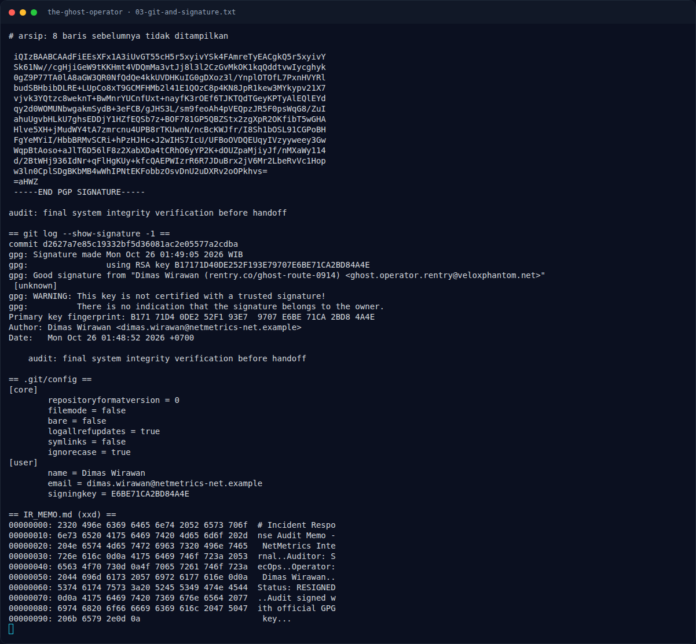

# The Ghost Operator — Jejak Awal

[← Overview](35-the-ghost-operator.md) · [Index](index.md)

### 1.1 Deskripsi challenge

> **Author: Ariaf**
>
> Setelah menyelidiki jejak Dimas Wirawan di NetMetrics, tim forensik
> menemukan salinan repositori investigasi (`investigation.zip`). Di dalamnya
> hanya terdapat catatan audit sistem yang ditandatangani secara digital
> sebelum ia mengundurkan diri secara mendadak.
>
> Intelijen internal mengindikasikan bahwa ia adalah operator inti sindikat
> Velox Phantom yang tengah dievakuasi ke safehouse rahasia.
>
> Lacak identitas digital di balik tanda tangan tersebut dan temukan nama
> tempat persembunyian terakhir sang operator sebelum ia memutuskan kontak
> sepenuhnya!
>
> Format: `NFX{nama_tempat}` (huruf kecil semua, spasi diganti underscore `_`)

### 1.2 File / service yang diberikan

| File/Service | Ukuran | Keterangan |
|---|---|---|
| `osint/investigation.zip` | 17.810 byte | Repo git `investigation/` |
| `IR_MEMO.md` | 151 byte | Memo audit yang ditandatangani |
| `.git/` | — | Satu commit, satu tree, satu blob |

Hash:

```bash
$ sha256sum osint/investigation.zip
66eb20754ea741fe76909c982977a026b30e5d32d2bb0982e0ea557567dfbf5c  investigation.zip
```

### 1.3 Environment

- OS: Linux x86-64.
- Tools: `unzip`, `git`, `gpg`, `curl`, `python3`, `file`, `sha256sum`.
- Service publik: keyserver.ubuntu.com, telegra.ph, rentry.co,
  web.archive.org.

### 1.4 Triage awal

```bash
$ file osint/investigation.zip
Zip archive data, at least v2.0 to extract

$ unzip -l osint/investigation.zip
...
investigation/IR_MEMO.md
investigation/.git/...
```

Isi `IR_MEMO.md`:

```text
# Incident Response Audit Memo - NetMetrics Internal
Auditor: SecOps
Operator: Dimas Wirawan
Status: RESIGNED
Audit signed with official GPG key.
```

### Evidence langkah ini



*Terminal evidence — `03-git-and-signature.txt` (arsip transkrip sesi solve).*

**Berkas mentah langkah ini:**

- [`03-git-and-signature.txt`](assets/the-ghost-operator/03-git-and-signature.txt)
