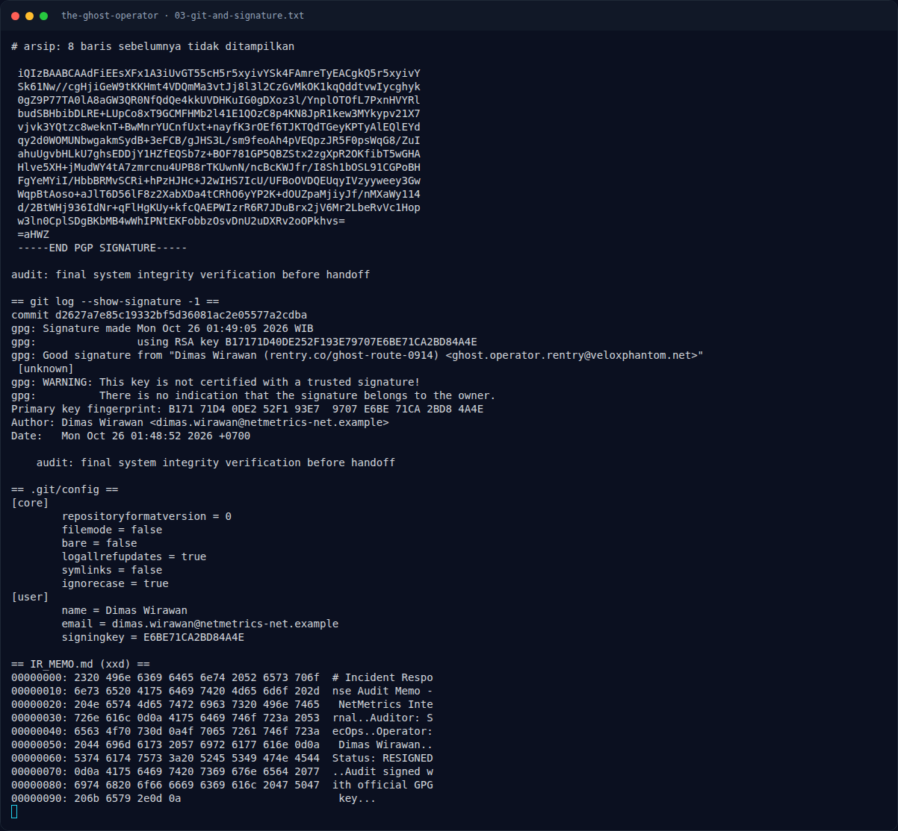

# The Ghost Operator — Analisis Jejak

[← Overview](35-the-ghost-operator.md) · [Index](index.md)

> **Langkah 2/9 — Analisis Jejak.** git config juga menyimpan signingkey = E6BE71CA2BD84A4E.
>
> **Titik penting:** git log --all --oneline --decorate · git log --show-signature -1 · cd investigation/investigation
>
> **Berikutnya:** [Analisis Jejak](35-the-ghost-operator-03-analisis-jejak-2.md)

## 2.1 Commit dan tanda tangan GPG

```bash
$ cd investigation/investigation
$ git log --all --oneline --decorate
d2627a7 (HEAD -> main) audit: final system integrity verification before handoff

$ git log --show-signature -1
gpg: Signature made Mon Oct 26 01:49:05 2026 WIB
gpg:                using RSA key B17171D40DE252F193E79707E6BE71CA2BD84A4E
gpg: Good signature from "Dimas Wirawan
     (rentry.co/ghost-route-0914)
     <ghost.operator.rentry@veloxphantom.net>" [unknown]
```

Commit mentah:

```text
tree 9c66f5f6c7a0e9d97984a6ee7d14d3aaab7c7922
author Dimas Wirawan <dimas.wirawan@netmetrics-net.example> 1792954132 +0700
committer Dimas Wirawan <dimas.wirawan@netmetrics-net.example> 1792954132 +0700
gpgsig -----BEGIN PGP SIGNATURE-----
...
```

`git config` juga menyimpan `signingkey = E6BE71CA2BD84A4E`.

## 2.2 Enumerasi keyserver

Key ID `E6BE71CA2BD84A4E` dapat diambil dari keyserver. UID-nya membocorkan
URL:

```text
Dimas Wirawan (rentry.co/ghost-route-0914)
<ghost.operator.rentry@veloxphantom.net>
```

Pencarian keyserver untuk domain `veloxphantom.net` menemukan **tiga key**:

| Fingerprint | UID |
|---|---|
| `A0BE3884C3DA0ED27A6D627338353AD29DC58103` | `Dimas Wirawan (telegra.ph/Field-Notes-0914-Escape-Route-10-25-2) <ghost.operator@veloxphantom.net>` |
| `BE7BB77BC5DC29E31149C1F9C92E23B3427F0BBC` | `Dimas Wirawan (telegra.ph/Field-Notes-0914-Escape-Route-10-25) <ghost.operator@veloxphantom.net>` |
| `B17171D40DE252F193E79707E6BE71CA2BD84A4E` | `Dimas Wirawan (rentry.co/ghost-route-0914) <ghost.operator.rentry@veloxphantom.net>` |

Ketiganya self-signed, dibuat dalam rentang waktu berdekatan
(2026-10-25). Ini menunjukkan operator membuat beberapa relay mirror.

### Evidence langkah ini



*Terminal evidence — `03-git-and-signature.txt` (arsip transkrip sesi solve).*

**Berkas mentah langkah ini:**

- [`03-git-and-signature.txt`](assets/the-ghost-operator/03-git-and-signature.txt)
