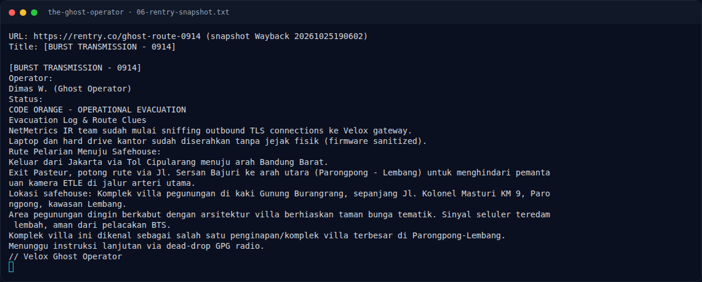

# The Ghost Operator — Identifikasi tempat

[← Overview](35-the-ghost-operator.md) · [Index](index.md)

> **Langkah 4/9 — Identifikasi tempat.** Sumber publik yang cocok:
>
> **Titik penting:** Sumber publik yang cocok:
>
> **Berikutnya:** [Mengapa lowercase ditolak?](35-the-ghost-operator-05-mengapa-lowercase-ditolak.md)

## 2.5 Identifikasi tempat

Empat elemen kunci:

1. **Jl. Kolonel Masturi KM 9**, Parongpong/Lembang.
2. **Kaki Gunung Burangrang**.
3. **Kompleks villa dengan taman bunga tematik**.
4. **Kompleks villa terbesar di Parongpong–Lembang**.

Sumber publik yang cocok:

- **Villa Istana Bunga (VIB)** — `penginapan.net` (15 Mei 2024) menyebut
  “kompleks villa seluas 42 hektar ... di bawah kaki Gunung Tangkuban
  Perahu yang bersebelahan dengan Gunung Burangrang”, alamat
  “Jl. Kolonel Masturi Km. 9, Parongpong, Cisarua, Lembang”, dan judul
  “Komplek Villa Terbesar di Lembang”.
- **villalembang09.com** menyebut “Villa Istana Bunga Lembang ... di
  jl. kolonel masturi km 9 parongpong lembang merupakan kawasan komplek
  villa terbesar di lembang”, luas ±42 hektar, ±300 unit villa.
- **sewavillabdg.com** (6 Mei 2026) menyebut “salah satu kompleks villa
  terbesar di kawasan Lembang ... Jl. Kolonel Masturi Km-9”.

Belum ditemukan kandidat lain di KM 9 yang memenuhi keempat elemen
sekaligus. Jadi safehouse yang dimaksud paling mungkin adalah
**Villa Istana Bunga (VIB)**.

### Evidence langkah ini

*Terminal evidence — `06-rentry-snapshot.txt` (arsip transkrip sesi solve).*

**Berkas mentah langkah ini:**

- [`06-rentry-snapshot.txt`](assets/the-ghost-operator/06-rentry-snapshot.txt)
