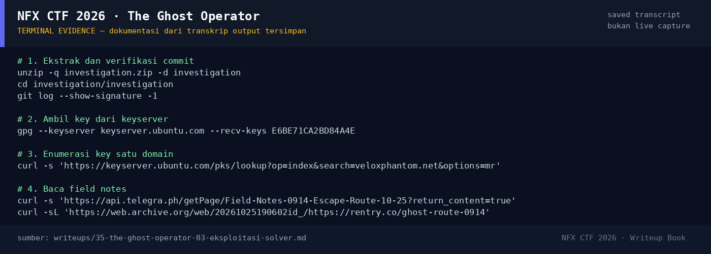

# The Ghost Operator — Evidence / Bukti

1 screenshot8 transkrip / script

[← Overview](35-the-ghost-operator.md) · [Index](index.md)

## Arsip Evidence

> Semua file di bawah berasal dari folder `assets/the-ghost-operator/`. Screenshot ditempel langsung; file teks/script ditautkan.

### Screenshot

<figure><figcaption>98-terminal-evidence.png</figcaption></figure>

### Transkrip / file pendukung

- [`01-investigation.zip`](assets/the-ghost-operator/01-investigation.zip)
- [`02-zip-metadata.txt`](assets/the-ghost-operator/02-zip-metadata.txt)
- [`03-git-and-signature.txt`](assets/the-ghost-operator/03-git-and-signature.txt)
- [`04-gpg-keys.txt`](assets/the-ghost-operator/04-gpg-keys.txt)
- [`05-telegraph-field-notes.txt`](assets/the-ghost-operator/05-telegraph-field-notes.txt)
- [`06-rentry-snapshot.txt`](assets/the-ghost-operator/06-rentry-snapshot.txt)
- [`07-vib-sources.md`](assets/the-ghost-operator/07-vib-sources.md)
- [`08-attempt-log.txt`](assets/the-ghost-operator/08-attempt-log.txt)

## Tabel Evidence

Semua bukti berada di `writeups/assets/the-ghost-operator/`.

| Bukti | File | Keterangan |
|---|---|---|
| Zip asli | `01-investigation.zip` | 17.810 byte |
| Metadata zip | `02-zip-metadata.txt` | Hash, daftar file |
| Git + GPG | `03-git-and-signature.txt` | Commit, signature, config |
| Tiga public key | `04-gpg-keys.txt` | Fingerprint + UID |
| Telegra.ph | `05-telegraph-field-notes.txt` | Isi lengkap 3 halaman |
| Snapshot rentry | `06-rentry-snapshot.txt` | Field notes dari Wayback |
| Sumber VIB | `07-vib-sources.md` | Kutipan alamat/karakteristik |
| Attempt log | `08-attempt-log.txt` | Urutan investigasi + status flag |