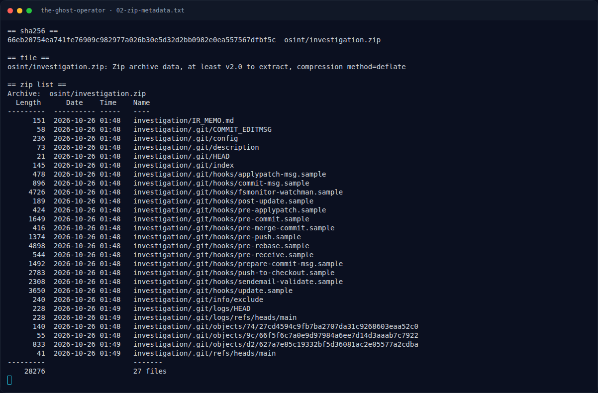

# The Ghost Operator — Mengapa lowercase ditolak?

[← Overview](35-the-ghost-operator.md) · [Index](index.md)

> **Langkah 5/9 — Mengapa lowercase ditolak?.** Deskripsi challenge meminta “huruf kecil semua, spasi diganti underscore”, sehingga secara logis jawabannya:
>
> **Titik penting:** NFX{villa_istana_bunga} · NFX{Villa_Istana_Bunga} · NFX{istana_bunga}
>
> **Berikutnya:** [Pencarian & Verifikasi](35-the-ghost-operator-06-pencarian-verifikasi.md)

## 2.6 Mengapa lowercase ditolak?

Deskripsi challenge meminta “huruf kecil semua, spasi diganti underscore”,
sehingga secara logis jawabannya:

```text
NFX{villa_istana_bunga}
```

Namun kandidat ini **ditolak** oleh platform. Kemungkinan penyebab:

1. **Author memakai ulang flag wave 1 tanpa normalisasi**: string yang
   pernah accepted adalah `NFX{Villa_Istana_Bunga}` (huruf kapital).
   Platform membandingkan case-sensitive.
2. **Ejaan “Vila” vs “Villa”**: bahasa Indonesia sering menulis “Vila”
   (satu L), sedangkan nama resmi kompleks memakai “Villa” (dua L).
3. **Nama yang diharapkan lebih pendek**: `NFX{istana_bunga}` atau
   `NFX{istanabunga}`.
4. **Nama lengkap dengan lokasi**: `NFX{villa_istana_bunga_lembang}`.

Verifikasi akhir: `NFX{villa_istana_bunga_lembang}` diterima platform
(`Correct! +380 points.`). Kandidat `NFX{villa_istana_bunga}` dan
`NFX{Villa_Istana_Bunga}` ditolak. Jadi author memakai nama tempat +
lokasi `lembang`, bukan hanya nama kompleks villa.

### Evidence langkah ini



*Terminal evidence — `02-zip-metadata.txt` (arsip transkrip sesi solve).*

**Berkas mentah langkah ini:**

- [`02-zip-metadata.txt`](assets/the-ghost-operator/02-zip-metadata.txt)
