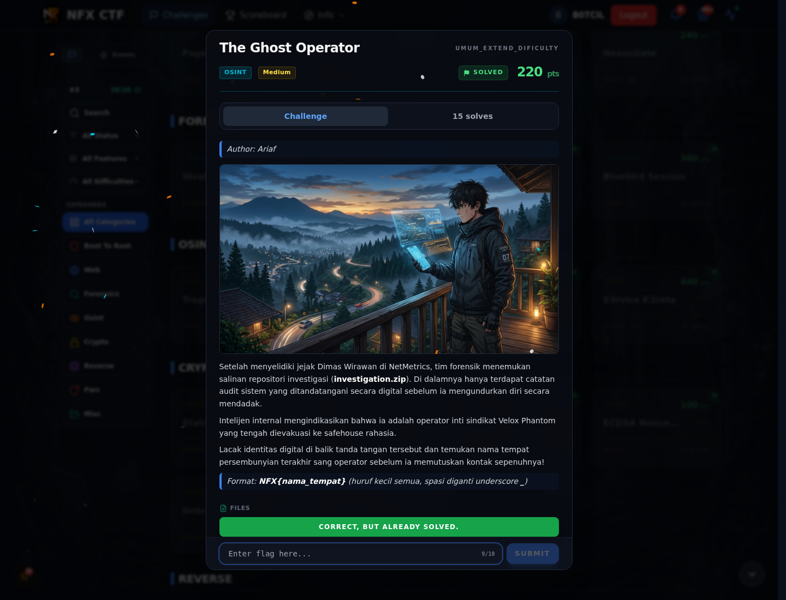

# The Ghost Operator — Flag & Verifikasi

[← Overview](35-the-ghost-operator.md) · [Index](index.md)

> **Langkah 7/9 — Flag.** Verifikasi platform (2026-11-08):
>
> **Titik penting:** NFX{villa_istana_bunga_lembang}
>
> **Berikutnya:** [Bukti / Evidence](35-the-ghost-operator-08-bukti-evidence.md)

> **Flag:** `NFX{villa_istana_bunga_lembang}`
> **Status:** `VERIFIED`

```text
NFX{villa_istana_bunga_lembang}
```

Verifikasi platform (2026-11-08):

```text
HTTP 200
{"success": true, "message": "Correct! +380 points."}
```

Riwayat kandidat:

| Kandidat | Status |
|---|---|
| `NFX{villa_istana_bunga}` | Ditolak |
| `NFX{Villa_Istana_Bunga}` | Ditolak |
| `NFX{VILLA_ISTANA_BUNGA}` | Ditolak |
| `NFX{villa_istana_bunga_lembang}` | **DITERIMA** (`Correct! +380 points.`) |

### Bukti submit di platform



*Submit flag di platform: `CORRECT, BUT ALREADY SOLVED.`*

> **Bukti submit:** screenshot form challenge di atas menampilkan `CORRECT, BUT ALREADY SOLVED.`
