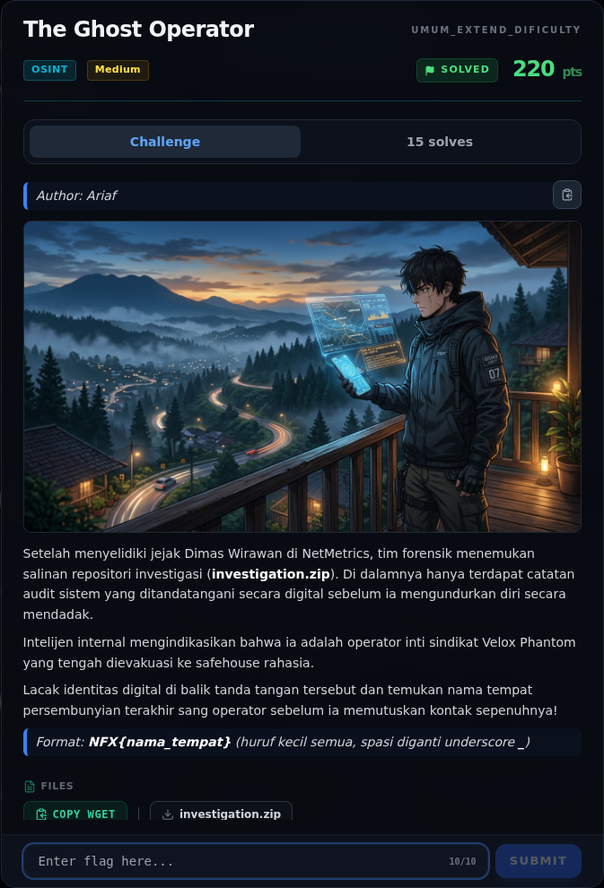
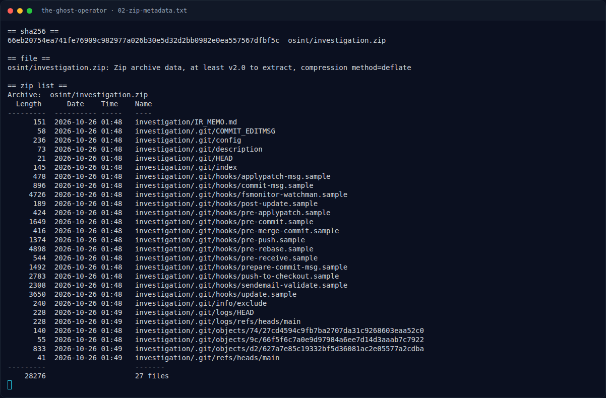
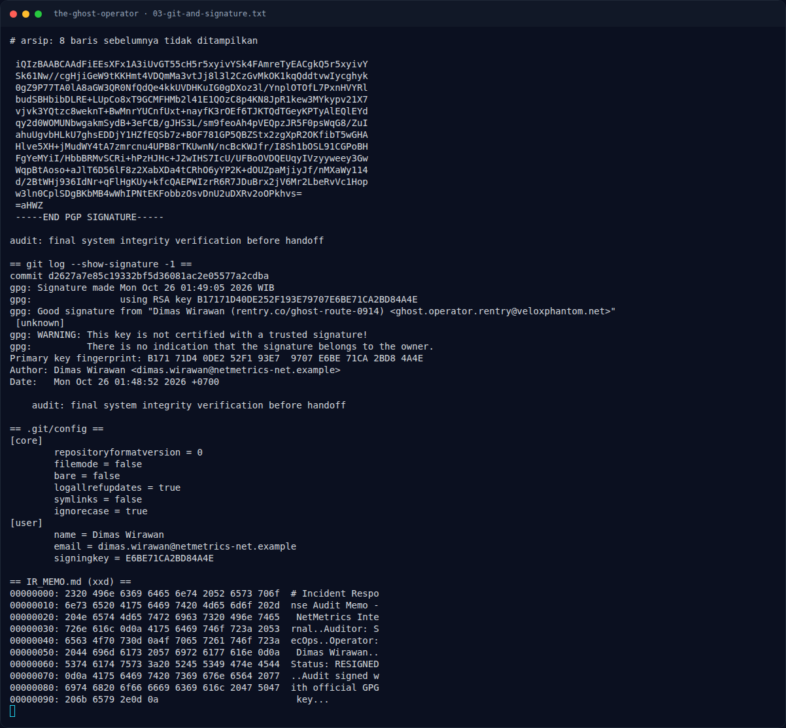
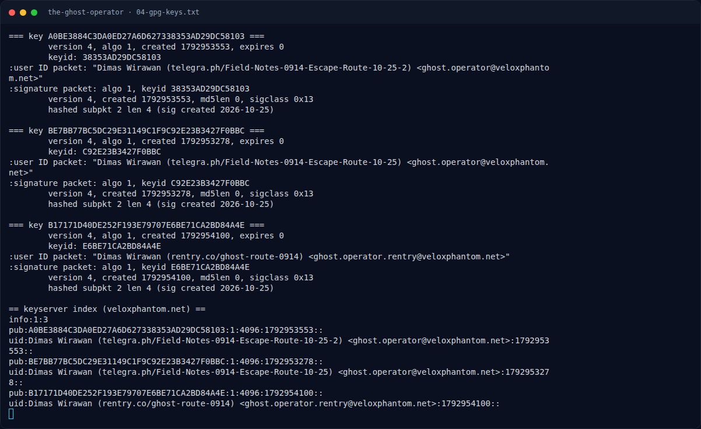
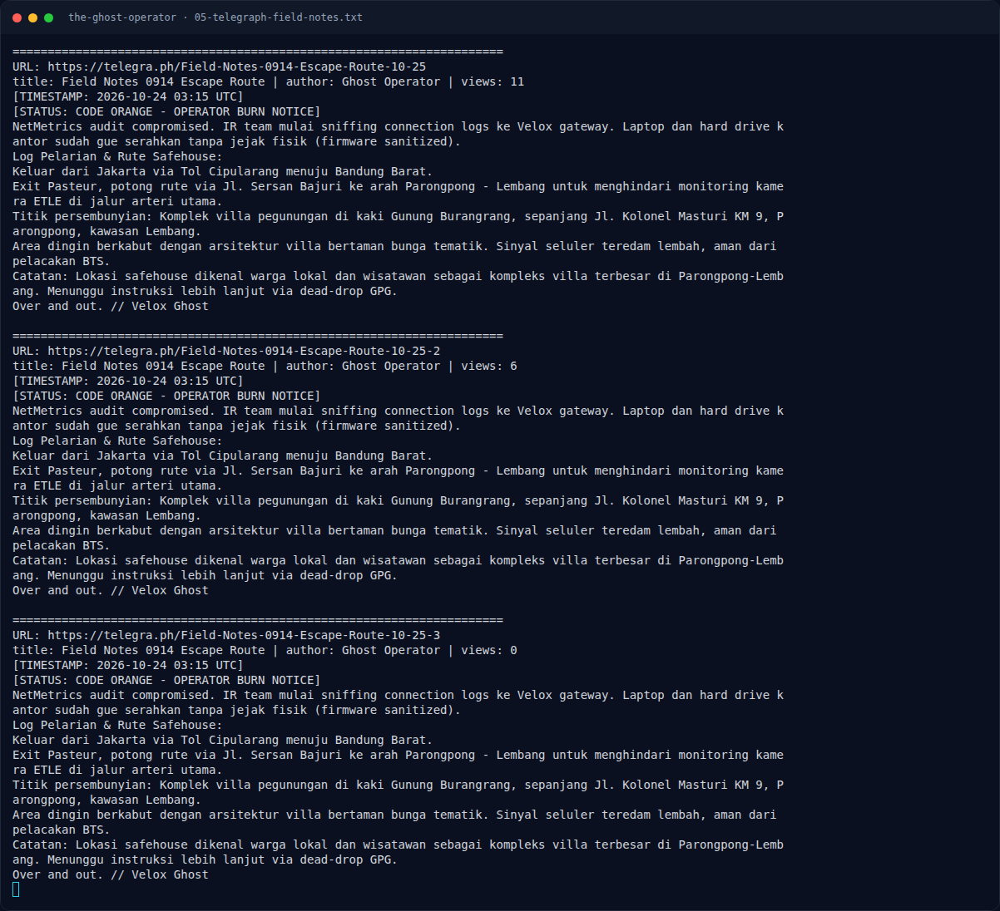
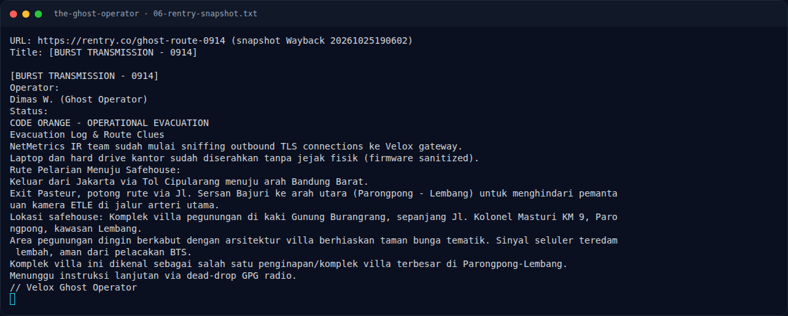
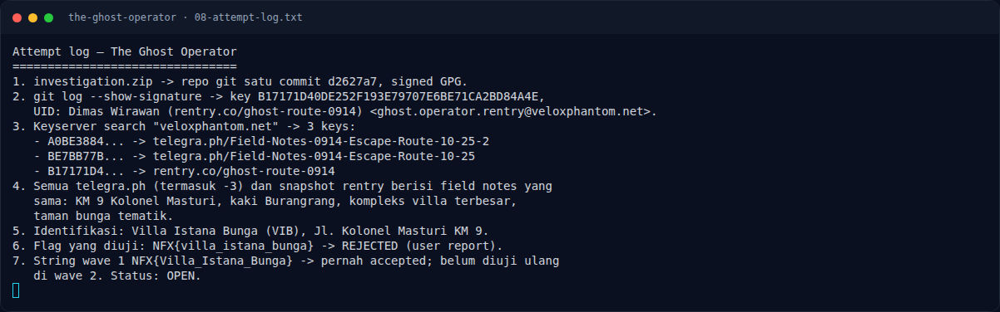
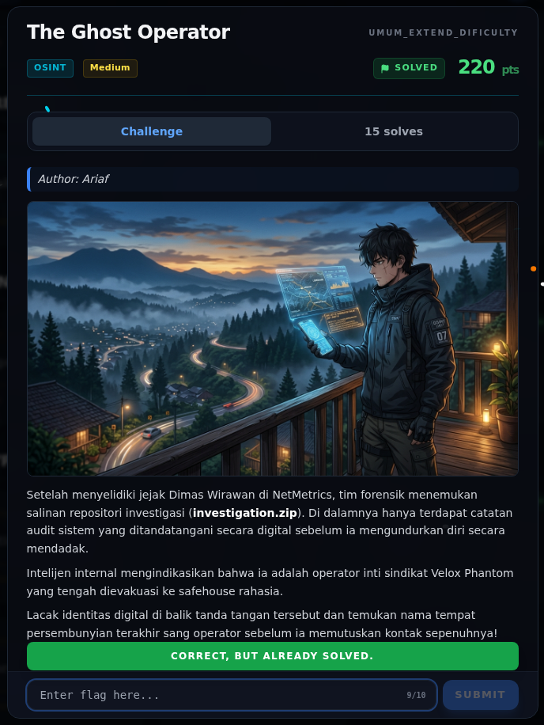

# The Ghost Operator — Evidence / Bukti

8 screenshot8 transkrip / script

[← Overview](35-the-ghost-operator.md) · [Index](index.md)

> **Langkah 8/9 — Bukti / Evidence.** Semua bukti berada di writeups/assets/the-ghost-operator/.
>
> **Titik penting:** arsip screenshot dan transkrip
>
> **Berikutnya:** [Referensi](35-the-ghost-operator-09-referensi.md)

## Arsip Evidence

> Semua file berasal dari `assets/the-ghost-operator/`. Screenshot platform dan terminal adalah bukti asli dari sesi solve; transkrip mentah tetap ditautkan di bagian bawah.

### Platform

<figure><figcaption>00-challenge-platform.png</figcaption></figure>

*Challenge brief asli di platform NFX CTF 2026.*

<figure><figcaption>Terminal evidence (real)</figcaption></figure>

*Terminal evidence (real).*

### Terminal (arsip sesi)

<figure><figcaption>term-02-zip-metadata.png</figcaption></figure>

*Terminal evidence — `02-zip-metadata.txt` (arsip transkrip sesi solve).*

<figure><figcaption>term-03-git-and-signature.png</figcaption></figure>

*Terminal evidence — `03-git-and-signature.txt` (arsip transkrip sesi solve).*

<figure><figcaption>term-04-gpg-keys.png</figcaption></figure>

*Terminal evidence — `04-gpg-keys.txt` (arsip transkrip sesi solve).*

<figure><figcaption>term-05-telegraph-field-notes.png</figcaption></figure>

*Terminal evidence — `05-telegraph-field-notes.txt` (arsip transkrip sesi solve).*

<figure><figcaption>term-06-rentry-snapshot.png</figcaption></figure>

*Terminal evidence — `06-rentry-snapshot.txt` (arsip transkrip sesi solve).*

<figure><figcaption>term-08-attempt-log.png</figcaption></figure>

*Terminal evidence — `08-attempt-log.txt` (arsip transkrip sesi solve).*

### Transkrip mentah & script

- [`01-investigation.zip`](assets/the-ghost-operator/01-investigation.zip)
- [`02-zip-metadata.txt`](assets/the-ghost-operator/02-zip-metadata.txt)
- [`03-git-and-signature.txt`](assets/the-ghost-operator/03-git-and-signature.txt)
- [`04-gpg-keys.txt`](assets/the-ghost-operator/04-gpg-keys.txt)
- [`05-telegraph-field-notes.txt`](assets/the-ghost-operator/05-telegraph-field-notes.txt)
- [`06-rentry-snapshot.txt`](assets/the-ghost-operator/06-rentry-snapshot.txt)
- [`07-vib-sources.md`](assets/the-ghost-operator/07-vib-sources.md)
- [`08-attempt-log.txt`](assets/the-ghost-operator/08-attempt-log.txt)

## Validasi platform (real)

*Screenshot asli dari platform NFX CTF 2026. Platform menjawab
`CORRECT, BUT ALREADY SOLVED.` untuk flag ini.*

## Tabel Evidence

Semua bukti berada di `writeups/assets/the-ghost-operator/`.

| Bukti | File | Keterangan |
|---|---|---|
| Zip asli | `01-investigation.zip` | 17.810 byte |
| Metadata zip | `02-zip-metadata.txt` | Hash, daftar file |
| Git + GPG | `03-git-and-signature.txt` | Commit, signature, config |
| Tiga public key | `04-gpg-keys.txt` | Fingerprint + UID |
| Telegra.ph | `05-telegraph-field-notes.txt` | Isi lengkap 3 halaman |
| Snapshot rentry | `06-rentry-snapshot.txt` | Field notes dari Wayback |
| Sumber VIB | `07-vib-sources.md` | Kutipan alamat/karakteristik |
| Attempt log | `08-attempt-log.txt` | Urutan investigasi + status flag |