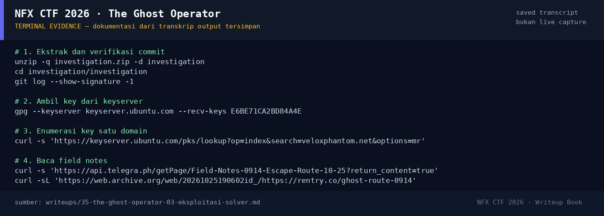

# The Ghost Operator

Track Umum / Extend · OsintMedium380 poinVERIFIED

| Field | Nilai |
|---|---|
| Event | `umum_Extend` |
| Kategori | `Osint` |
| Difficulty | `Medium` |
| Poin | `380` |
| Author | `Ariaf` |
| Solves | `7` |
| Tools | curl, python3, sage, angr, git, gpg |
| Flag | `NFX{villa_istana_bunga_lembang}` |
| Status | `VERIFIED` |

[← Kembali ke Index](index.md)

## Ringkasan

> Catatan verifikasi: kandidat `NFX{villa_istana_bunga}` dan
> `NFX{Villa_Istana_Bunga}` **ditolak**. String yang diterima adalah
> `NFX{villa_istana_bunga_lembang}` (nama tempat + lokasi Lembang).
## TL;DR

- `investigation.zip` berisi repo git dengan satu commit yang **ditandatangani
  GPG**.
- `git log --show-signature` membuka identitas key:
  `Dimas Wirawan (rentry.co/ghost-route-0914)`.
- Enumerasi keyserver `veloxphantom.net` menemukan **tiga key**:
  - dua key mengarah ke `telegra.ph/Field-Notes-0914-Escape-Route-10-25`
    (dan varian `-2`);
  - satu key mengarah ke `rentry.co/ghost-route-0914`.
- Semua field notes (telegra.ph, telegra.ph `-2`, `-3`, dan snapshot rentry)
  berisi petunjuk yang sama: kompleks villa di **Jl. Kolonel Masturi KM 9**,
  kaki **Gunung Burangrang**, **taman bunga tematik**, dan **kompleks villa
  terbesar di Parongpong–Lembang**.
- Tempat yang cocok: **Villa Istana Bunga (VIB)**, Jl. Kolonel Masturi KM 9,
  Parongpong/Lembang.
- Flag yang diterima platform: `NFX{villa_istana_bunga_lembang}` —
  nama safehouse + kota Lembang (bukan sekadar `villa_istana_bunga`).

Pratinjau evidence. Buka halaman <a href="35-the-ghost-operator-05-bukti-evidence.html">Evidence / Bukti</a> untuk semua screenshot dan transkrip.

## Navigasi Halaman

<a class="nx-page-card" href="35-the-ghost-operator-01-recon.html"><b>Recon</b>Enumerasi target dan bukti awal</a>
<a class="nx-page-card" href="35-the-ghost-operator-02-analisis.html"><b>Analisis</b>Membaca alur dan akar masalah</a>
<a class="nx-page-card" href="35-the-ghost-operator-03-eksploitasi-solver.html"><b>Eksploitasi / Solver</b>Langkah exploit dan solver</a>
<a class="nx-page-card" href="35-the-ghost-operator-04-flag.html"><b>Flag</b>Flag dan verifikasi platform</a>
<a class="nx-page-card" href="35-the-ghost-operator-05-bukti-evidence.html"><b>Bukti / Evidence</b>Screenshot, transkrip, dan artefak</a>
<a class="nx-page-card" href="35-the-ghost-operator-06-referensi.html"><b>Referensi</b>Sumber dan bacaan lanjutan</a>

