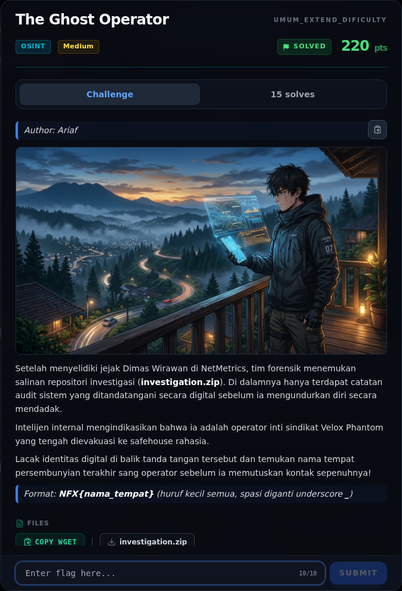
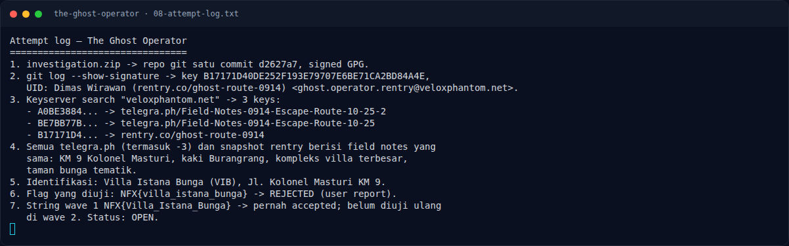

# The Ghost Operator

Track Umum / Extend · OsintMedium380 poinVERIFIED

| Field | Nilai |
|---|---|
| Event | `umum_Extend` |
| Kategori | `Osint` |
| Difficulty | `Medium` |
| Poin | `380` |
| Author | `Ariaf` |
| Solves | `7` |
| Tools | curl, python3, sage, angr, git, gpg |
| Flag | `NFX{villa_istana_bunga_lembang}` |
| Status | `VERIFIED` |
[← Kembali ke Index](index.md)

## Challenge Brief (platform)

*Challenge brief asli di platform NFX CTF 2026.*

## Cerita singkat

Jadi ceritanya gini. `investigation.zip` berisi repo git dengan satu commit yang **ditandatangani GPG**. Terus, `git log --show-signature` membuka identitas key: `Dimas Wirawan (rentry.co/ghost-route-0914)`. Lalu, enumerasi keyserver `veloxphantom.net` menemukan **tiga key**:. Nah, dari situ kita bisa sampai ke flag dan bukti submit-nya.

## Alur & Titik Penting

| # | Langkah | Titik penting | Buka |
|---:|---|---|---|
| 1 | Jejak Awal | sha256sum osint/investigation.zip | [Buka](35-the-ghost-operator-01-jejak-awal.md) |
| 2 | Analisis Jejak | git log --all --oneline --decorate | [Buka](35-the-ghost-operator-02-analisis-jejak.md) |
| 3 | Analisis Jejak | Dua URL telegra.ph dapat diakses langsung. | [Buka](35-the-ghost-operator-03-analisis-jejak-2.md) |
| 4 | Identifikasi tempat | Sumber publik yang cocok: | [Buka](35-the-ghost-operator-04-identifikasi-tempat.md) |
| 5 | Mengapa lowercase ditolak? | NFX{villa_istana_bunga} | [Buka](35-the-ghost-operator-05-mengapa-lowercase-ditolak.md) |
| 6 | Pencarian & Verifikasi | curl -s 'https://keyserver.ubuntu.com/pks/lookup?op=index&search=veloxphantom.net&options=mr' | [Buka](35-the-ghost-operator-06-pencarian-verifikasi.md) |
| 7 | Flag | NFX{villa_istana_bunga_lembang} | [Buka](35-the-ghost-operator-07-flag.md) |
| 8 | Bukti / Evidence | arsip screenshot dan transkrip | [Buka](35-the-ghost-operator-08-bukti-evidence.md) |
| 9 | Referensi | NFX{Villa_Istana_Bunga} | [Buka](35-the-ghost-operator-09-referensi.md) |

## Ringkasan

> Catatan verifikasi: kandidat `NFX{villa_istana_bunga}` dan
> `NFX{Villa_Istana_Bunga}` **ditolak**. String yang diterima adalah
> `NFX{villa_istana_bunga_lembang}` (nama tempat + lokasi Lembang).
## TL;DR

- `investigation.zip` berisi repo git dengan satu commit yang **ditandatangani
  GPG**.
- `git log --show-signature` membuka identitas key:
  `Dimas Wirawan (rentry.co/ghost-route-0914)`.
- Enumerasi keyserver `veloxphantom.net` menemukan **tiga key**:
  - dua key mengarah ke `telegra.ph/Field-Notes-0914-Escape-Route-10-25`
    (dan varian `-2`);
  - satu key mengarah ke `rentry.co/ghost-route-0914`.
- Semua field notes (telegra.ph, telegra.ph `-2`, `-3`, dan snapshot rentry)
  berisi petunjuk yang sama: kompleks villa di **Jl. Kolonel Masturi KM 9**,
  kaki **Gunung Burangrang**, **taman bunga tematik**, dan **kompleks villa
  terbesar di Parongpong–Lembang**.
- Tempat yang cocok: **Villa Istana Bunga (VIB)**, Jl. Kolonel Masturi KM 9,
  Parongpong/Lembang.
- Flag yang diterima platform: `NFX{villa_istana_bunga_lembang}` —
  nama safehouse + kota Lembang (bukan sekadar `villa_istana_bunga`).

Pratinjau evidence. Buka halaman <a href="35-the-ghost-operator-08-bukti-evidence.html">Evidence / Bukti</a> untuk semua screenshot dan transkrip.

## Navigasi Halaman

<a class="nx-page-card" href="35-the-ghost-operator-01-jejak-awal.html"><b>Jejak Awal</b>Baca bagian ini</a>
<a class="nx-page-card" href="35-the-ghost-operator-02-analisis-jejak.html"><b>Analisis Jejak</b>Membaca alur dan akar masalah</a>
<a class="nx-page-card" href="35-the-ghost-operator-03-analisis-jejak-2.html"><b>Analisis Jejak</b>Membaca alur dan akar masalah</a>
<a class="nx-page-card" href="35-the-ghost-operator-04-identifikasi-tempat.html"><b>Identifikasi tempat</b>Baca bagian ini</a>
<a class="nx-page-card" href="35-the-ghost-operator-05-mengapa-lowercase-ditolak.html"><b>Mengapa lowercase ditolak?</b>Baca bagian ini</a>
<a class="nx-page-card" href="35-the-ghost-operator-06-pencarian-verifikasi.html"><b>Pencarian &amp; Verifikasi</b>Baca bagian ini</a>
<a class="nx-page-card" href="35-the-ghost-operator-07-flag.html"><b>Flag</b>Flag dan verifikasi platform</a>
<a class="nx-page-card" href="35-the-ghost-operator-08-bukti-evidence.html"><b>Bukti / Evidence</b>Screenshot, transkrip, dan artefak</a>
<a class="nx-page-card" href="35-the-ghost-operator-09-referensi.html"><b>Referensi</b>Sumber dan bacaan lanjutan</a>

