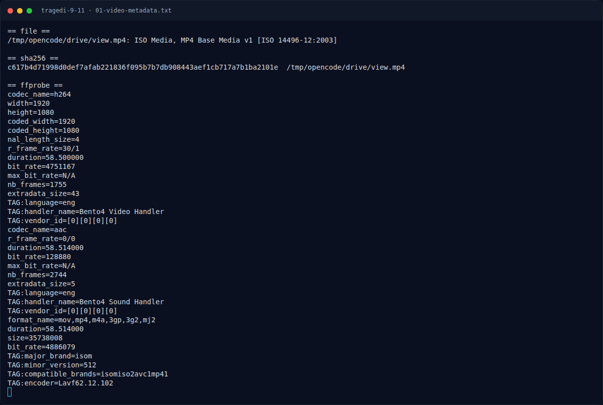

# Tragedi 9/11 — Triage awal

[← Overview](36-tragedi-9-11.md) · [Index](index.md)

> **Langkah 2/8 — Triage awal.** Triage awal
>
> **Titik penting:** file drive/view.mp4 · ffprobe -v error -show_format -show_streams drive/view.mp4
>
> **Berikutnya:** [Analisis Jejak](36-tragedi-9-11-03-analisis-jejak.md)

## 1.4 Triage awal

```bash
$ file drive/view.mp4
ISO Media, MP4 Base Media v1 [IS0 14496-12:2003]

$ ffprobe -v error -show_format -show_streams drive/view.mp4
codec_name=h264        width=1920   height=1080
r_frame_rate=30/1      duration=58.500000
bit_rate=4751167       nb_frames=1755
codec_name=aac         duration=58.514000
format_name=mov,mp4    size=35738008
encoder=Lavf62.12.102
```

**Temuan:** video adalah rekaman asli berdurasi 58,5 detik, bukan slideshow
atau file rusak. Tidak ada metadata lokasi/timestamp yang bisa dipakai
langsung; pivot harus dilakukan dari isi video dan jejak unggahan.

### Evidence langkah ini



*Terminal evidence — `01-video-metadata.txt` (arsip transkrip sesi solve).*

**Berkas mentah langkah ini:**

- [`01-video-metadata.txt`](assets/tragedi-9-11/01-video-metadata.txt)
