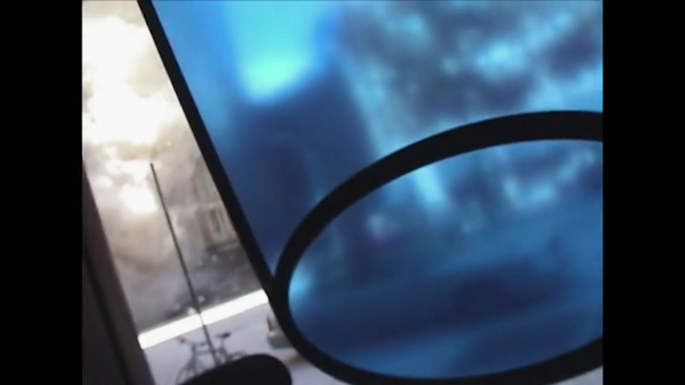

# Tragedi 9/11 — Analisis Jejak

[← Overview](36-tragedi-9-11.md) · [Index](index.md)

## 2.1 Mengenali video

Isi video: kamera merekam kepulan debu setelah runtuhnya menara; seorang
pria (pemilik toko) menarik/mengarahkan seorang wanita masuk ke dalam toko;
debu menutup jalan di luar. Ini adalah klip yang dikenal sebagai:

```text
"Shop owner saves woman's life from wall of dust on 9/11"
```

Video ini menjadi viral pada peringatan 20 tahun 9/11 (September 2021).

## 2.2 Pivot ke Reddit

Postingan yang membagikan video:

```text
Subreddit : r/PublicFreakout
Title     : Shop owner saves woman's life from wall of dust on 9/11
Posted by : u/PigParkerPt2
Date      : September 11, 2021 22:13 UTC
Video URL : https://v.redd.it/tf2es5z87ym71
Post URL  : https://www.reddit.com/r/PublicFreakout/comments/pmgkqi/shop_owner_saves_womans_life_from_wall_of_dust_on/
```

Atribusi ini juga dikutip oleh berita:

- La Opinión (12 Sep 2021): “El impresionante video fue compartido por
  u/PigParkerPt2 en la red social Reddit...”
- El Diario NY (12 Sep 2021): “El aterrador video fue compartido por
  u/PigParkerPt2 en Reddit...”

Reddit memblokir akses langsung dari environment ini (403/network policy),
tetapi judul, username, dan URL terverifikasi lewat hasil pencarian publik
dan dua artikel berita yang mengutip unggahan tersebut.

## 2.3 Pivot ke GitHub

Username `PigParkerPt2` dicari di GitHub. Ditemukan user dengan ID
`351115424` dan beberapa repo, salah satunya:

```text
https://github.com/PigParkerPt2/xor-operation
```

Repo ini terlihat seperti proyek Go kecil (encrypt/decrypt XOR). Saat
di-clone, file yang terlihat di HEAD hanya:

```text
.gitignore
go.sum
domain/encrypt_xor_domain.go
dto/encrypt_dto.go
dto/response.go
main.go
.env.example
```

Tidak ada `.env` dan tidak ada flag di file saat ini. Ini cocok dengan
petunjuk “tempat yang tampaknya tidak menyimpan apa-apa”.

### Evidence langkah ini



*Evidence — `02-video-frame-30s.png`.*
