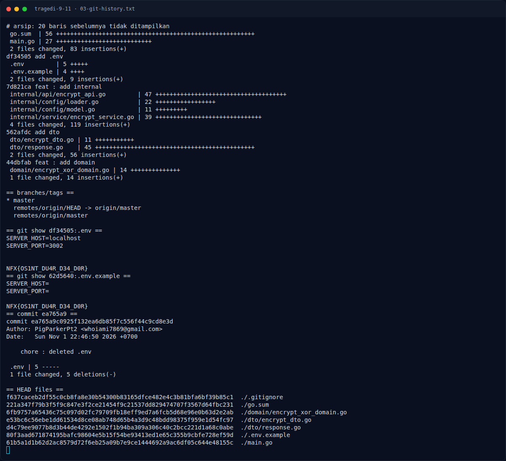

# Tragedi 9/11 — Analisis Jejak

[← Overview](36-tragedi-9-11.md) · [Index](index.md)

## 2.4 Melihat history, bukan HEAD

```bash
$ git log --all --oneline --stat
c00a353 feat : change decrypt service.go
1433bb3 feat : add decrypt_service.go
4fe9d80 feat : add decrypt_api.go
d7909fd feat : remove config in .env.example
43de7b7 feat : add .gitignore
ea765a9 chore : deleted .env
62d5640 feat : add main.go
df34505 add .env
7d821ca feat : add internal
562afdc add dto
44dbfab feat : add domain
```

Commit `df34505` (“add .env”) menambahkan `.env` dan `.env.example`.
Commit `ea765a9` (“chore : deleted .env”) menghapus `.env` dari HEAD.
Namun objek commit lama tetap ada.

## 2.5 Membaca `.env` lama

```bash
$ git show df34505:.env
SERVER_HOST=localhost
SERVER_PORT=3002

NFX{OS1NT_DU4R_D34_D0R}
```

Commit `62d5640` juga masih menyimpan flag di `.env.example`:

```bash
$ git show 62d5640:.env.example
SERVER_HOST=
SERVER_PORT=

NFX{OS1NT_DU4R_D34_D0R}
```

Commit `d7909fd` (“remove config in .env.example”) menghapus baris flag dari
`.env.example`, sehingga file saat ini terlihat bersih. Tetapi history
tetap menyimpan semuanya.

## 2.6 Timeline commit

| Commit | Pesan | Peran |
|---|---|---|
| `df34505` | `add .env` | **Menambahkan flag** ke `.env` |
| `62d5640` | `feat : add main.go` | Flag juga ada di `.env.example` |
| `ea765a9` | `chore : deleted .env` | Menghapus `.env` dari HEAD |
| `43de7b7` | `feat : add .gitignore` | Menambahkan `.gitignore` |
| `d7909fd` | `feat : remove config in .env.example` | Menghapus flag dari `.env.example` |
| `4fe9d80` | `feat : add decrypt_api.go` | File baru |
| `1433bb3` | `feat : add decrypt_service.go` | File kosong |
| `c00a353` | `feat : change decrypt service.go` | File diisi |

### Evidence langkah ini



*Terminal evidence — `03-git-history.txt` (arsip transkrip sesi solve).*


*Evidence — `02-video-frame-30s.png`.*

**Berkas mentah langkah ini:**

- [`03-git-history.txt`](assets/tragedi-9-11/03-git-history.txt)
