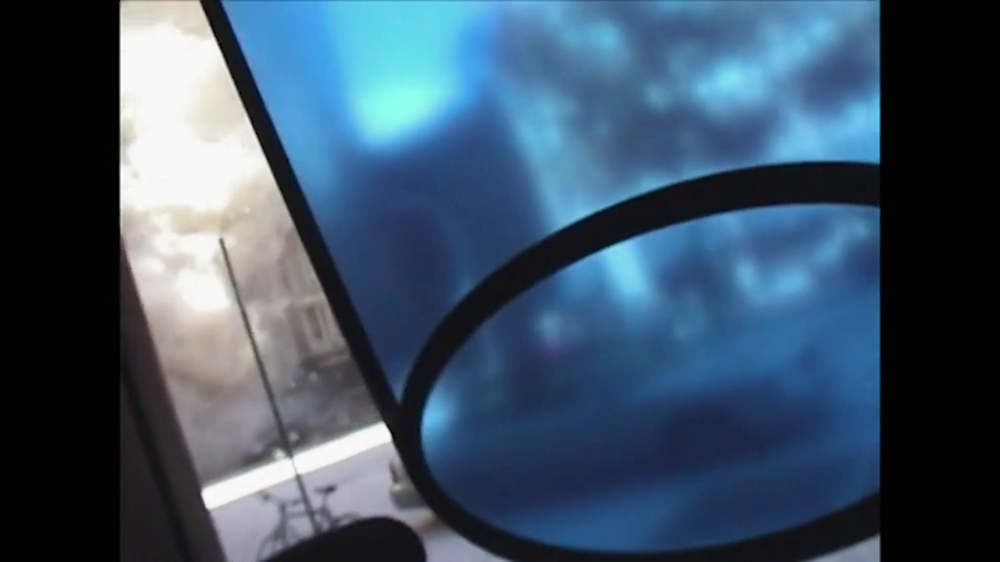

# Tragedi 9/11 — Evidence / Bukti

[← Overview](36-tragedi-9-11.md) · [Index](index.md)

## Arsip Evidence

> Semua file di bawah berasal dari folder `assets/tragedi-9-11/`. Screenshot ditempel langsung; file teks/script ditautkan.

### Screenshot

### Transkrip / file pendukung

- [`01-video-metadata.txt`](assets/tragedi-9-11/01-video-metadata.txt)
- [`03-git-history.txt`](assets/tragedi-9-11/03-git-history.txt)
- [`04-reddit-post.txt`](assets/tragedi-9-11/04-reddit-post.txt)
- [`05-github-repo.txt`](assets/tragedi-9-11/05-github-repo.txt)

## Tabel Evidence

Semua bukti berada di `writeups/assets/tragedi-9-11/`.

| Bukti | File | Keterangan |
|---|---|---|
| Metadata video | `01-video-metadata.txt` | Durasi 58,5 s, 1920×1080, H.264/AAC, hash |
| Frame video | `02-video-frame-30s.png` | Frame pada detik ke-30 |
| Git history | `03-git-history.txt` | Log, branch, isi `.env` lama |
| Reddit post | `04-reddit-post.txt` | Username, judul, URL, kutipan berita |
| GitHub repo | `05-github-repo.txt` | Commit relevan dan isi `.env` |
