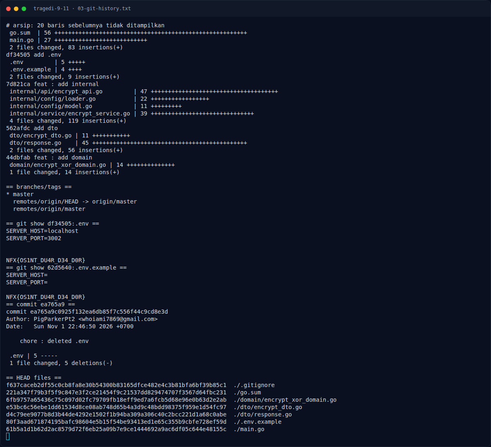

# Tragedi 9/11 — Pencarian & Verifikasi

[← Overview](36-tragedi-9-11.md) · [Index](index.md)

### 3.1 Strategi

1. Identifikasi video → cari unggahan asli di Reddit.
2. Ambil username pengunggah (`PigParkerPt2`).
3. Cari username yang sama di GitHub.
4. Clone repo `xor-operation`.
5. Periksa **commit history**, bukan hanya file di HEAD.
6. Baca `.env` pada commit yang menambahkannya.

### 3.2 Perintah

```bash
# 1. Clone repo
git clone https://github.com/PigParkerPt2/xor-operation.git
cd xor-operation

# 2. Lihat semua commit
git log --all --oneline --stat

# 3. Cari commit yang menambahkan .env
git log --all --oneline -- .env

# 4. Baca .env dari commit lama
git show df34505:.env

# 5. Cek .env.example lama
git show 62d5640:.env.example
```

### 3.3 Output asli

```text
$ git log --all --oneline -- .env
ea765a9 chore : deleted .env
df34505 add .env

$ git show df34505:.env
SERVER_HOST=localhost
SERVER_PORT=3002

NFX{OS1NT_DU4R_D34_D0R}
```

### Evidence langkah ini



*Terminal evidence — `03-git-history.txt` (arsip transkrip sesi solve).*
