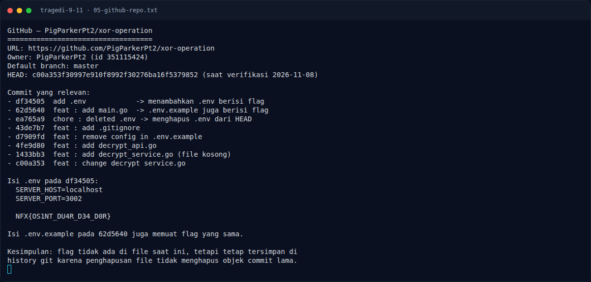

# Tragedi 9/11 — Flag & Verifikasi

[← Overview](36-tragedi-9-11.md) · [Index](index.md)

> **Langkah 6/8 — Flag.** Flag ini **belum disubmit** ke platform, jadi statusnya OPEN / UNVERIFIED.
>
> **Titik penting:** NFX{OS1NT_DU4R_D34_D0R}
>
> **Berikutnya:** [Bukti / Evidence](36-tragedi-9-11-07-bukti-evidence.md)

> **Flag:** `NFX{OS1NT_DU4R_D34_D0R}` (kandidat)
> **Status:** `OPEN / UNVERIFIED`

```text
NFX{OS1NT_DU4R_D34_D0R}
```

Verifikasi:

```text
$ git show df34505:.env | tr -d '\r'
SERVER_HOST=localhost
SERVER_PORT=3002

NFX{OS1NT_DU4R_D34_D0R}

$ git show 62d5640:.env.example | tr -d '\r'
SERVER_HOST=
SERVER_PORT=

NFX{OS1NT_DU4R_D34_D0R}
```

Flag ini **belum disubmit** ke platform. Bukti lokal (git history live)
konsisten, tetapi status `VERIFIED` hanya boleh dipakai setelah ada submit
sukses. Karena itu halaman ini memakai `OPEN / UNVERIFIED` sampai diverifikasi.

### Terminal evidence (real)



*Terminal evidence (real).*

> **Bukti:** terminal evidence (real).
