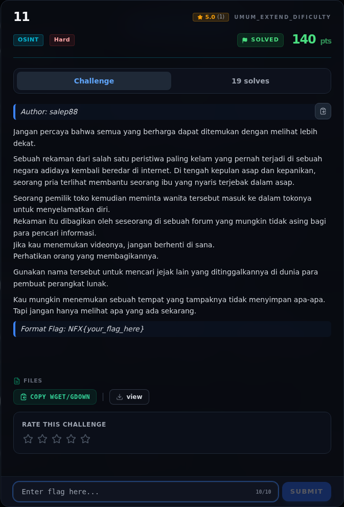
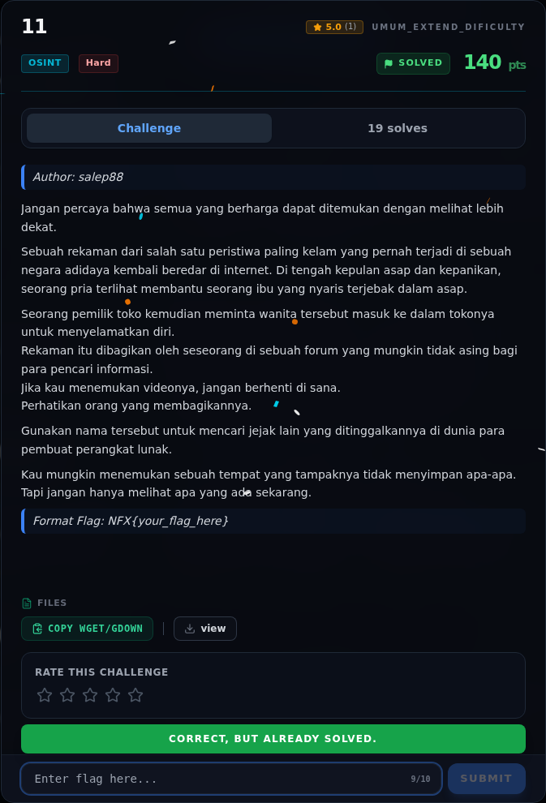
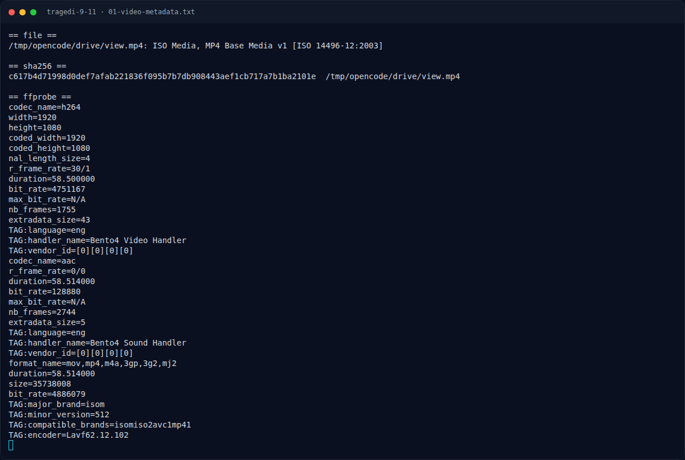
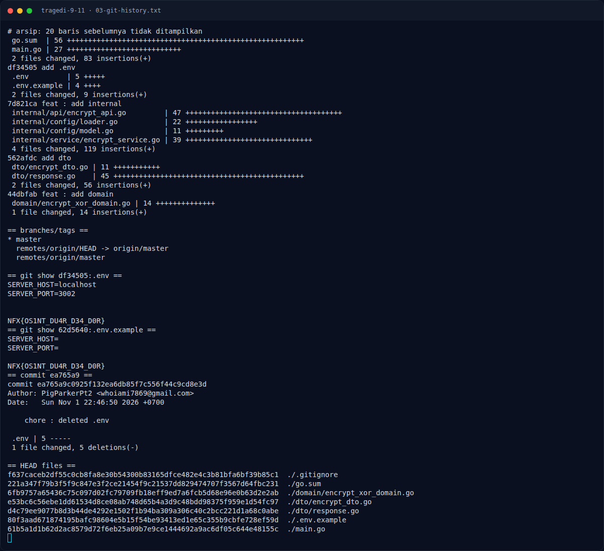
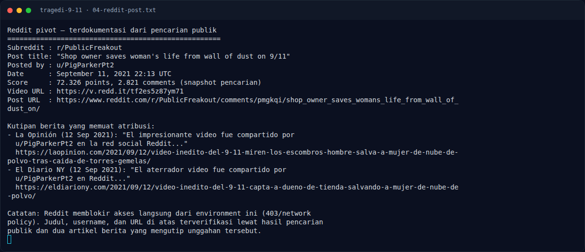
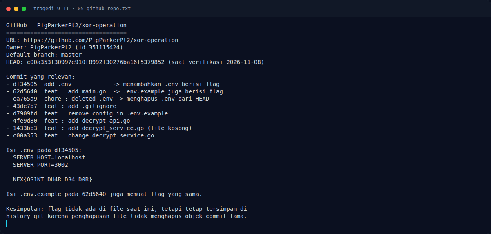
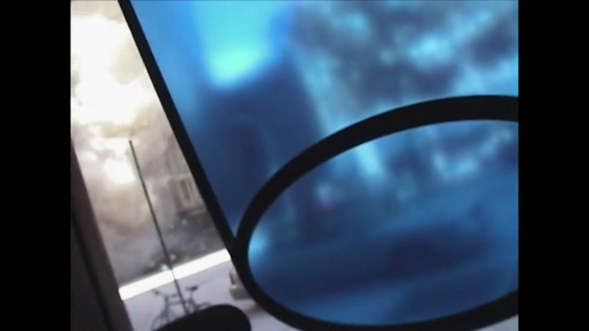

# Tragedi 9/11 — Evidence / Bukti

7 screenshot4 transkrip / script

[← Overview](36-tragedi-9-11.md) · [Index](index.md)

## Arsip Evidence

> Semua file berasal dari `assets/tragedi-9-11/`. Screenshot platform dan terminal adalah bukti asli dari sesi solve; transkrip mentah tetap ditautkan di bagian bawah.

### Platform

<figure><figcaption>00-challenge-platform.png</figcaption></figure>

*Challenge brief asli di platform NFX CTF 2026.*

<figure><figcaption>00b-submit-platform.png</figcaption></figure>

*Submit flag di platform: `CORRECT, BUT ALREADY SOLVED.`*

### Terminal (arsip sesi)

<figure><figcaption>term-01-video-metadata.png</figcaption></figure>

*Terminal evidence — `01-video-metadata.txt` (arsip transkrip sesi solve).*

<figure><figcaption>term-03-git-history.png</figcaption></figure>

*Terminal evidence — `03-git-history.txt` (arsip transkrip sesi solve).*

<figure><figcaption>term-04-reddit-post.png</figcaption></figure>

*Terminal evidence — `04-reddit-post.txt` (arsip transkrip sesi solve).*

<figure><figcaption>term-05-github-repo.png</figcaption></figure>

*Terminal evidence — `05-github-repo.txt` (arsip transkrip sesi solve).*

### Screenshot langkah

<figure><figcaption>02-video-frame-30s.png</figcaption></figure>

*Evidence — `02-video-frame-30s.png`.*

### Transkrip mentah & script

- [`01-video-metadata.txt`](assets/tragedi-9-11/01-video-metadata.txt)
- [`03-git-history.txt`](assets/tragedi-9-11/03-git-history.txt)
- [`04-reddit-post.txt`](assets/tragedi-9-11/04-reddit-post.txt)
- [`05-github-repo.txt`](assets/tragedi-9-11/05-github-repo.txt)

## Tabel Evidence

Semua bukti berada di `writeups/assets/tragedi-9-11/`.

| Bukti | File | Keterangan |
|---|---|---|
| Metadata video | `01-video-metadata.txt` | Durasi 58,5 s, 1920×1080, H.264/AAC, hash |
| Frame video | `02-video-frame-30s.png` | Frame pada detik ke-30 |
| Git history | `03-git-history.txt` | Log, branch, isi `.env` lama |
| Reddit post | `04-reddit-post.txt` | Username, judul, URL, kutipan berita |
| GitHub repo | `05-github-repo.txt` | Commit relevan dan isi `.env` |